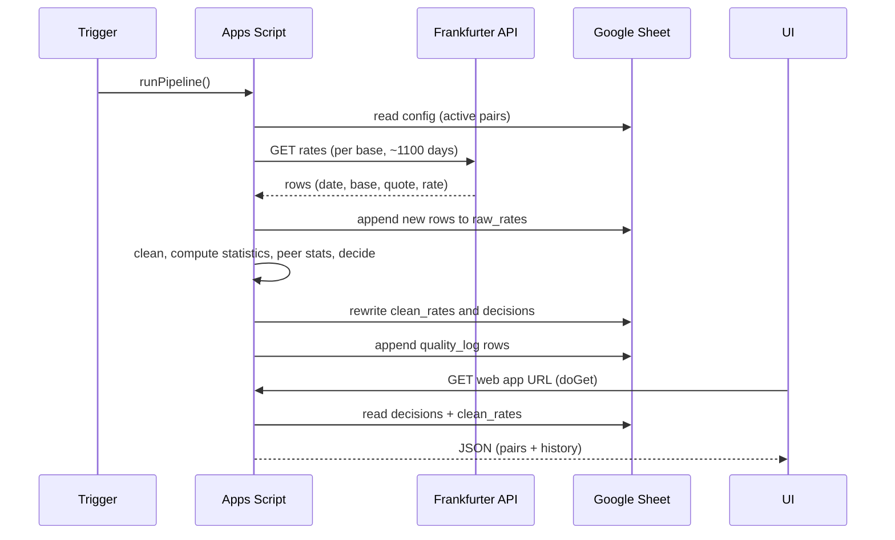

# FX Timing Helper

> A free, serverless currency-exchange **decision-support** tool.
> Daily FX data from a free API -> Google Sheets -> automatic cleaning -> statistics -> a plain-language decision -> a premium, animated web UI.

**Status:** the Google Apps Script backend is complete, deployed, and included in full in [section 14](#14-step-by-step-setup-google-sheets--apps-script). The web UI (`index.html`, `styles.css`, `engine.js`, `app.js`) is built: it analyses **any From -> To currency pair** live in the browser and shows the Sheet's tracked pairs as a watchlist. **Action needed:** `Code.gs` changed (weekend rates are now skipped, see 6.4). Re-paste it and redeploy as a new version (Step 12).

**Disclaimer:** this project provides decision support, not financial advice. Rates are reference rates, not what your bank or transfer provider will charge.

---

## Table of contents

1. [Project overview](#1-project-overview)
2. [Design decisions](#2-design-decisions)
3. [Data source](#3-data-source)
4. [Architecture](#4-architecture)
5. [Google Sheet data model](#5-google-sheet-data-model)
6. [Pipeline stages in detail](#6-pipeline-stages-in-detail)
7. [Statistics reference](#7-statistics-reference)
8. [Decision engine](#8-decision-engine)
9. [Configuration](#9-configuration)
10. [JSON API contract](#10-json-api-contract)
11. [UI design (premium, minimal, animated)](#11-ui-design-premium-minimal-animated)
12. [Capacity and limits](#12-capacity-and-limits)
13. [Testing and status](#13-testing-and-status)
14. [Step-by-step setup: Google Sheets + Apps Script](#14-step-by-step-setup-google-sheets--apps-script)
15. [Risks and limitations](#15-risks-and-limitations)
16. [Roadmap](#16-roadmap)
17. [Appendix](#17-appendix)

---

## 1. Project overview

### 1.1 The problem

People who move money between currencies (students paying tuition, people sending money home, freelancers paid abroad, small importers) usually ask: **"Is today a good day to convert, or should I wait?"** Most tools show a raw rate and a chart, and leave the judgment to the user.

### 1.2 The solution

FX Timing Helper reads daily exchange-rate data, stores it in Google Sheets, cleans it, computes a set of statistics, and turns them into a clear recommendation such as:

> **CONVERT HALF NOW** - best rate in 5 months. Better than 84% of the last 90 days. If you wait 10 trading days, history says the rate ended better for you 54% of the time; a bad case is -2.0% and a good case is +2.0%.

### 1.3 Core design stance (important)

- **It does not predict exchange rates.** Short-term FX behaves close to a random walk. The tool answers "is today's rate unusually good or bad compared with history, and what has waiting cost or gained in the past?"
- **It is explainable.** Every decision is rule-based and ships with a reason string and a list of indicator votes.
- **It is honest.** It shows confidence, data freshness, and a "historical edge" check that exposes when timing signals do not beat average days.

### 1.4 Goals

| Goal | How it is met |
|---|---|
| Free to run | Free API (no key), Google Sheets, Apps Script, static hosting |
| No server to maintain | Apps Script time trigger + web-app endpoint |
| Trustworthy data | Raw/clean separation, validation rules, quality log |
| Useful decisions | Level score + suggested % to convert now + reasons |
| Many currencies | Config-driven pairs; the API covers roughly 220 currencies |
| Premium experience | Minimal, calm UI with an intro sequence, scroll reveals and hover micro-interactions |

### 1.5 Non-goals

- Live tick-by-tick trading data (the source publishes reference rates once or a few times per day).
- Price prediction or trading signals.
- Executing or comparing actual transfers.

---

## 2. Design decisions

Why the project looks the way it does:

| Decision | Reason |
|---|---|
| **Google Sheets as the store** | Free, visible, editable by hand, no server. Daily FX data is tiny, so Sheets capacity is not a concern (see [Capacity and limits](#12-capacity-and-limits)). A database is only needed for high-frequency data. |
| **Frankfurter API** | Free, no key, about 220 currencies, deep history, no quotas, and caching its data is explicitly allowed. |
| **Apps Script for everything backend** | Triggers, HTTP fetch, sheet I/O and a JSON web endpoint all live with the Sheet. No other service to maintain. |
| **Rule-based decisions** | Explainable and testable without training data. Every output has a reason. |
| **Config-driven pairs** | Add a currency by adding a row in the `config` tab; no code changes. |
| **Rich statistics, simple output** | Percentiles, moving averages, MACD, RSI, Bollinger, volatility, rank, "days since a better rate", wait range, regime, basket strength, fee check, target probability and votes are computed, but the user sees one headline, one action and one reason. |
| **Premium minimal UI** | A decision tool must feel calm and trustworthy. Motion is used to guide attention, never to decorate. |

---

## 3. Data source

### 3.1 Primary source: Frankfurter (v2)

| Property | Value |
|---|---|
| Base URL | `https://api.frankfurter.dev/v2/rates` |
| Authentication | None (no API key) |
| Coverage | About 220 currencies plus some metals, from about 111 central banks and official sources. Use `/v2/currencies` for the live list |
| History | Daily history back decades for many currencies; depth varies per currency |
| Frequency | Reference rates published once or a few times a day. **Not live market quotes** |
| Limits | No monthly or daily caps; requests are rate-limited to prevent abuse. HTTP 503 with `Retry-After` when busy |
| Rate type | Mid-market, blended across providers by default |
| Storage | Caching daily observations in your own store is explicitly encouraged |

Parameters for `/v2/rates`: `base` (default `EUR`), `quotes` (comma-separated), `from`, `to` (`YYYY-MM-DD`), optional `group` (`week`/`month`) and `providers`. Use **uppercase** currency codes.

Response (per the official OpenAPI spec): a **bare JSON array** of rate objects. The base currency's own row (`rate: 1`) is included and is ignored by the script.

```json
[
  { "date": "2024-01-15", "base": "EUR", "quote": "GBP", "rate": 0.8623 },
  { "date": "2024-01-15", "base": "EUR", "quote": "USD", "rate": 1.089 }
]
```

Useful endpoints:

```
GET /v2/rates?base=USD&quotes=INR,EUR&from=2023-11-01&to=2026-11-14   # time series
GET /v2/rate/USD/INR                                                  # single pair
GET /v2/currencies                                                    # supported list
GET /v2/coverage                                                      # queryable date bounds
GET /v2/providers                                                     # data providers
```

Notes:

- **v1 is deprecated but still works.** v1 is ECB-only (about 31 currencies). The script automatically falls back to v1 (`/v1/{from}..{to}?base=USD&symbols=INR`) if v2 fails or returns nothing.
- The parser also accepts NDJSON, `{rates:[...]}` and the v1 nested shape, so a format change does not break the pipeline. Run `testFetch()` first anyway.
- Blended rates may shift in the last decimal places as new provider data arrives. The script keeps the first value it sees for each date (see [limitations](#15-risks-and-limitations)).

### 3.2 Optional secondary source (not implemented)

A second provider can cross-check today's rate and lower confidence on a mismatch. Candidates: exchangerate-api.com (free tier about 1,500 requests per month, needs a key) and open.er-api.com (wider currency set, no history). On the [roadmap](#16-roadmap).

---

## 4. Architecture

### 4.1 System diagram

```
                    +-----------------------------------------------+
                    |   Google Apps Script (bound to the Sheet)      |
                    |                                                |
  Daily time        |  runPipeline()                                 |
  trigger  -------> |   1. readConfig_()      <-- config sheet       |
  (18:00)           |   2. fetchAll_()        --> Frankfurter v2/v1  |
                    |   3. appendNewRaw_()    --> raw_rates          |
                    |   4. cleanPair_()                              |
                    |   5. computeStats_()                           |
                    |   6. addPeerStats_()    (cross-pair)           |
                    |   7. decide_()                                 |
                    |   8. write clean / decisions / quality_log     |
                    |                                                |
                    |  doGet()  ----------------> JSON / JSONP       |
                    +---------------------+--------------------------+
                                          |
                       Google Sheet (storage layer)
          config | raw_rates | clean_rates | decisions | quality_log
                                          |
                                          v
                           Static premium web UI (built)  
                  GitHub Pages / Netlify / Cloudflare Pages
```

### 4.2 Components

| Component | Technology | Responsibility |
|---|---|---|
| Scheduler | Apps Script time-driven trigger | Runs `runPipeline()` once a day |
| Fetcher | `UrlFetchApp` | Pulls the time series, one call per base currency, retries on 429/503, v1 fallback |
| Storage | Google Sheets (5 tabs) | Config, raw data, clean data, decisions, logs |
| Cleaner | Apps Script | Validation, deduplication, spike detection |
| Analyst | Apps Script (pure functions) | Statistics and historical analysis |
| Decision engine | Apps Script (rule-based) | Score, suggested conversion %, reason, confidence |
| API | Apps Script web app (`doGet`) | Serves decisions and history as JSON (JSONP fallback), cached 10 minutes |
| Menu | `onOpen()` | "FX Helper" menu in the Sheet to run each step without opening the editor |
| UI | Static HTML/CSS/vanilla JS (`index.html`, `styles.css`, `app.js`) | Board, detail, money view, animations |

### 4.3 Design principles

1. **Raw is sacred.** `raw_rates` is append-only and never edited.
2. **Clean is derived.** `clean_rates` and `decisions` are rebuilt every run.
3. **Idempotent runs.** Raw rows are keyed by `date|base|quote`; re-running never duplicates data (verified in tests).
4. **Fail soft.** A failed currency is logged and skipped; its previous decision row is kept. One bad currency in a group triggers per-currency retries.
5. **Few API calls.** Currencies are grouped by base, so 10 USD pairs take one request.
6. **Pure functions for logic.** Statistics and decision functions take plain arrays and return plain objects.
7. **Explainability first.** Every decision outputs a reason, indicator votes and a confidence level.
8. **UI reads a small payload.** The UI never scans the sheets; it uses `doGet()`.
9. **One run at a time.** A script lock prevents overlapping runs.

### 4.4 Data flow (one daily run)



### 4.5 Why these choices

| Choice | Reason | Trade-off |
|---|---|---|
| Google Sheets as storage | Free, visible, editable, no server; daily data is tiny | Slow past ~500k-1M cells; weak querying |
| Apps Script | Built-in triggers, free, lives with the Sheet | Quotas; web-app redirects can complicate CORS (JSONP fallback provided) |
| Frankfurter v2 | Free, no key, ~220 currencies, history, no quotas | Daily reference rates only |
| Rule-based decision | Explainable, testable, no training data needed | Weights are judgment, not fitted |
| Static UI | Free hosting, fast, simple | Needs the web-app URL to be public |

---

## 5. Google Sheet data model

The workbook has five tabs, created by `setup()`. Extra empty columns are deleted to save cells.

### 5.1 `config`

One row per tracked pair. Edit this sheet to add currencies; no code changes needed.

| Column | Type | Meaning |
|---|---|---|
| `pair_id` | text | Informational label (the script computes `BASE/QUOTE` itself) |
| `base` | text | Base currency code, e.g. `USD` |
| `quote` | text | Quote currency code, e.g. `INR` |
| `higher_is_better` | TRUE/FALSE | TRUE = you **sell** base and want more quote per base. FALSE = you must **buy** base and want fewer quote per base |
| `deadline_days` | number | Days until you must convert. Blank = no deadline (10-trading-day horizon). **Update this yourself as the date approaches** |
| `active` | TRUE/FALSE | Include in runs (blank = TRUE) |
| `fee_pct` | number | Your provider's total cost in percent. Blank or `0` = feature skipped |
| `target_rate` | number | Optional target rate. Blank = skipped |

Default pairs: USD to INR, EUR, GBP, JPY, CAD, AUD, CHF, MXN, PHP, SGD (14-day deadline, `higher_is_better = TRUE`). `TRUE`, `YES`, `Y` and `1` are all read as true.

### 5.2 `raw_rates` (append-only)

| Column | Meaning |
|---|---|
| `date` | `yyyy-MM-dd` as text |
| `base`, `quote` | Currency codes |
| `rate` | Rate as returned by the API |
| `source` | `frankfurter-v2` or `frankfurter-v1` (fallback) |
| `fetched_at` | ISO timestamp of the run that first stored the row |

### 5.3 `clean_rates` (rebuilt each run)

| Column | Meaning |
|---|---|
| `date`, `pair`, `base`, `quote`, `rate` | Validated, deduplicated, sorted data |
| `is_outlier` | TRUE if flagged by the spike rule (kept for display, excluded from statistics) |

Only the last `KEEP_CLEAN_DAYS` (400) rows per pair are stored; statistics use the full history from `raw_rates`.

### 5.4 `decisions` (rebuilt each run, sorted by score descending)

One row per pair, 85 columns, grouped:

| Group | Columns |
|---|---|
| Identity | `updated_at`, `pair`, `base`, `quote`, `higher_is_better`, `deadline_days`, `rate`, `rate_date`, `data_age_days`, `points`, `outliers_flagged` |
| Decision | `score`, `decision`, `headline`, `convert_now_pct`, `confidence`, `reason` |
| Indicator votes | `signals_good`, `signals_total`, `signals_detail` (format `name=1;name=0;...`) |
| Position | `pct30`, `pct90`, `pct252`, `rank_1y`, `days_since_better`, `history_days`, `z30`, `z90` |
| Levels | `mean30`, `mean90`, `std30`, `min90`, `max90`, `range_pos90`, `vs_mean30_pct`, `vs_best90_pct` |
| Trend | `sma7`, `sma30`, `sma90`, `ema12`, `ema26`, `macd`, `macd_signal`, `macd_hist`, `momentum` |
| Oscillators | `rsi14`, `boll_pctB`, `boll_bandwidth` |
| Trend strength | `trend_slope30_pct_day`, `trend_r2_30`, `trend_slope90_pct_day`, `trend_r2_90` |
| Volatility and moves | `vol30_ann_pct`, `vol_ratio`, `avg_daily_move_pct`, `mom1_pct`, `mom7_pct`, `mom30_pct`, `exp_move7_pct` |
| Behaviour | `variance_ratio5`, `autocorr1`, `regime` |
| Wait analysis | `wait_horizon_obs`, `wait_p05_pct`, `wait_p50_pct`, `wait_p95_pct`, `wait_prob_better` |
| Fees and target | `fee_pct`, `fee_vs_weekly_move`, `target_rate`, `target_gap_pct`, `target_prob` |
| Peer strength | `base_strength_pct90`, `base_strong_count`, `base_peers`, `rel_mom30_vs_basket` |
| Historical edge | `edge_n`, `edge_bucket_mean7`, `edge_base_mean7`, `edge_bucket_win`, `edge_base_win` |

"Favorable" figures (`pct*`, `vs_*`, `trend_slope*`, `wait_*`, `target_gap_pct`, `edge_*`) are signed from the user's point of view: positive is good for you, whether you are buying or selling. `z30`, `z90`, `mom*_pct`, `rsi14` and `boll_pctB` are raw market values.

### 5.5 `quality_log` (append-only)

| Column | Meaning |
|---|---|
| `run_at`, `pair` | When and which pair |
| `rows_fetched`, `rows_new` | Rows returned by the API and rows newly added to raw |
| `duplicates`, `invalid`, `outliers` | Counts from cleaning |
| `latest_date`, `data_age_days` | Newest clean data point and its age in days |
| `status` | `OK`, `WARN` (stale, short history or fetch problem with old data still usable) or `ERROR` (no data) |
| `note` | Error or warning details |

### 5.6 Formatting detail

Date columns are set to plain-text format so Google Sheets never auto-converts `2026-11-13` into a date value. The script also normalises any date that was converted by accident.

---

## 6. Pipeline stages in detail

Entry point: `runPipeline()` (protected by a script lock).

### 6.1 Read config - `readConfig_()`

Reads the `config` tab, keeps active rows with a base and quote, upper-cases codes, builds `id = BASE/QUOTE`, drops duplicates and `BASE = QUOTE` rows.

### 6.2 Fetch - `fetchAll_()`, `fetchOne_()`, `httpGet_()`, `parseRows_()`

- Look-back window: `LOOKBACK_DAYS = 1100` (about 3 years).
- One request per **base currency** with all its quotes.
- `httpGet_()` retries up to 3 times on HTTP 429, 503, other 5xx and network errors (2 s, 4 s back-off). 4xx errors are not retried.
- If v2 fails or returns no rows, `fetchOne_()` tries the v1 API.
- If a grouped request fails, or a quote is missing from the reply, each affected quote is fetched alone; individual failures are recorded per pair.
- `parseRows_()` normalises any supported shape into rows of `{date, base, quote, rate}` and drops the base's own `rate: 1` row.

### 6.3 Raw storage - `appendNewRaw_()`

Loads existing `date|base|quote` keys, appends only new rows with a positive numeric rate, and returns per-pair counts. The in-memory result (old + new rows) feeds the next stages, so statistics use the full stored history.

### 6.4 Clean - `cleanPair_()`

| # | Check | Action |
|---|---|---|
| 1 | Date not `yyyy-MM-dd`, or rate missing, non-numeric, or <= 0 | Reject, count as `invalid` |
| 1b | Saturday or Sunday | Skipped. The API publishes thin weekend prints, but the statistics assume trading days (252 a year, 5 a week). `raw_rates` keeps them |
| 2 | Same date appears twice | Keep the later one, count as `duplicates` |
| 3 | Order | Sort ascending by date |
| 4 | Spikes | Daily log returns compared with median and MAD (robust sigma = 1.4826 x MAD). A point is an outlier when the jump **into** it and the jump **out of** it both exceed **6** sigma and point in opposite directions. The newest point (no "out" jump yet) is flagged only above 12 sigma. Flagged rows are kept but excluded from statistics |
| 5 | Freshness | Data older than 4 days -> `WARN` and low confidence (covers a weekend plus one holiday) |
| 6 | Completeness | Fewer than 30 clean points: pair skipped with `WARN`; fewer than 120: low confidence |

Why the spike rule: a bad data point is a spike (up then straight back down), while a genuine one-way move such as a devaluation is a step. The rule removes spikes and keeps steps. Pegged currencies (MAD = 0) skip spike detection.

Weekends and holidays are not filled with invented values.

### 6.5 Statistics - `computeStats_()`

Computes everything in [Statistics reference](#7-statistics-reference) on the non-outlier series. Returns `null` if fewer than 30 clean points.

### 6.6 Peer statistics - `addPeerStats_()`

When a base has at least three tracked pairs, calculates how strong the base is across the basket and how much each pair's 30-day move differs from the others.

### 6.7 Decision - `decide_()`

See [Decision engine](#8-decision-engine).

### 6.8 Output

- `writeClean_()` rewrites `clean_rates` and trims unused rows.
- `writeDecisions_()` merges new decisions over previous rows (a pair that failed today keeps yesterday's row; pairs no longer active are removed), sorts by score, rewrites the tab.
- `appendLog_()` appends quality-log rows.
- The JSON cache is cleared so the UI sees fresh data immediately.

### 6.9 Scheduling - `installTrigger()`

Creates a daily trigger at `TRIGGER_HOUR` (default 18) in the **script's time zone**. Set the project time zone to Europe/Berlin (or similar) so the run lands after the ECB's mid-afternoon publish. Re-running replaces the existing trigger.

### 6.10 Entry points

| Function | Purpose |
|---|---|
| `onOpen()` | Adds the **FX Helper** menu to the Sheet |
| `setup()` | Creates tabs and headers, fills default config, sets text formats. Safe to re-run; keeps config and raw data, clears old decision rows |
| `testFetch()` | Fetches 10 days for the first pair and logs the source, row count and first rows |
| `runPipeline()` | Full daily run |
| `installTrigger()` | Installs the daily trigger |
| `doGet(e)` | JSON / JSONP endpoint |

---

## 7. Statistics reference

Let `rates` be the clean, non-outlier series, `last` the latest rate, `dir = +1` if `higher_is_better` else `-1`. "Favorable" values are multiplied by `dir` so higher always means better for the user.

### 7.1 Position within history

| Statistic | Definition | Interpretation |
|---|---|---|
| `pct30`, `pct90`, `pct252` | Share of the last 30 / 90 / 252 observations (including today) that are as good as or worse (for you) than today | 0.85 = better than 85% of the window |
| `rank_1y` | 1 + number of days in the last year that were strictly better for you | 1 = best day of the year |
| `days_since_better` | Calendar days since a strictly better rate; blank if none in the whole history | "Best rate in N months" |
| `history_days` | Calendar days from first to last clean point | Depth of history |
| `z30`, `z90` | (last - mean) / standard deviation over 30 / 90 observations | Raw, not direction-flipped |
| `min90`, `max90`, `range_pos90` | 90-day low, high and where today sits (0 to 1) | Raw range position |
| `vs_mean30_pct`, `vs_best90_pct` | Percent better than the 30-day mean; percent away from the 90-day best (favorable-signed, <= 0) | Regret measure |

### 7.2 Trend and momentum

| Statistic | Definition |
|---|---|
| `sma7`, `sma30`, `sma90` | Simple moving averages |
| `ema12`, `ema26` | Exponential moving averages (k = 2/(period+1)) |
| `macd`, `macd_signal`, `macd_hist` | EMA12 - EMA26; EMA9 of MACD; difference |
| `momentum` | `favorable` if `dir * macd_hist > 0`, else `unfavorable` |
| `trend_slope30_pct_day`, `trend_slope90_pct_day` | Least-squares slope of log(rate) per observation x 100, favorable-signed |
| `trend_r2_30`, `trend_r2_90` | R-squared of that fit: how clean the trend is (0 to 1) |
| `mom1_pct`, `mom7_pct`, `mom30_pct` | Raw percent change over 1, 7, 30 observations |

### 7.3 Oscillators

| Statistic | Definition |
|---|---|
| `rsi14` | Wilder's RSI, 14 periods. Above 70 stretched high, below 30 stretched low |
| `boll_pctB` | (last - lower band) / (upper - lower), 20-period mean +/- 2 standard deviations. 1 = at the upper band |
| `boll_bandwidth` | (upper - lower) / mean |

### 7.4 Volatility and expected movement

| Statistic | Definition |
|---|---|
| `vol30_ann_pct` | Standard deviation of 30 daily log returns x sqrt(252) x 100 |
| `vol_ratio` | 30-day volatility / 90-day volatility. Above 1.5 = elevated |
| `avg_daily_move_pct` | Mean absolute daily return over 30 days |
| `exp_move7_pct` | One-sigma one-week move: daily standard deviation x sqrt(5) x 100 (5 trading days) |

### 7.5 Behaviour (does the pair trend or snap back?)

| Statistic | Definition |
|---|---|
| `variance_ratio5` | Variance of overlapping 5-step returns / (5 x variance of 1-step returns), last ~252 returns. ~1 random walk, < 1 mean-reverting, > 1 trending |
| `autocorr1` | Lag-1 autocorrelation of daily returns |
| `regime` | `mean-reverting` if variance ratio < 0.85, `trending` if > 1.15, else `random-like`. **Rule-of-thumb thresholds** |

### 7.6 Waiting analysis

Horizon `h` = round(deadline_days x 5 / 7) observations, limited to 1-60 (10 if no deadline). Uses every `h`-step window in the history (windows overlap). Needs at least 20 windows.

| Statistic | Definition |
|---|---|
| `wait_p05_pct`, `wait_p50_pct`, `wait_p95_pct` | 5th, 50th, 95th percentile of the favorable change after `h` observations |
| `wait_prob_better` | Share of windows where the rate ended better for you |
| `target_gap_pct` | Improvement needed to reach `target_rate` (<= 0 means already reached) |
| `target_prob` | Share of windows whose **best** point within `h` reached the needed improvement; 1 if already reached |

### 7.7 Peer / basket strength

| Statistic | Definition |
|---|---|
| `base_strength_pct90` | Average raw 90-day position of the base across all tracked pairs with the same base |
| `base_strong_count`, `base_peers` | Pairs where the base is at or above its 80th 90-day percentile, and the number of pairs |
| `rel_mom30_vs_basket` | This pair's 30-day move minus the average of the others. >= 1.5 points means the move is specific to this currency |

### 7.8 Historical edge

For every past day, compute its 90-day favorable percentile and the favorable change over the next 7 observations. Compare days whose percentile is within 0.10 of today's with all days.

| Statistic | Meaning |
|---|---|
| `edge_n` | Number of similar past days (needs at least 30 for the bucket figures) |
| `edge_bucket_mean7`, `edge_base_mean7` | Average next-week favorable change: similar days vs. all days |
| `edge_bucket_win`, `edge_base_win` | Share of positive outcomes: similar days vs. all days |

This is the honesty check. If similar-level days do not differ from average days, timing signals are weak and splitting is the safer advice.

### 7.9 Indicator votes

Seven binary votes that the **level** is good for you:

1. 90-day percentile >= 0.6
2. 1-year percentile >= 0.6
3. Favorable Bollinger position >= 0.6
4. Favorable z-score vs. 90 days >= 0.5
5. Favorable RSI >= 55
6. Better than the 30-day average
7. 7-day average favorable relative to the 30-day average

---

## 8. Decision engine

### 8.1 Level score (0-100)

```
score = 100 * ( 0.40 * favPct90
              + 0.25 * favPct252
              + 0.20 * favBoll
              + 0.15 * clamp((favZ90 + 2) / 4, 0, 1) )
```

The score measures **how good today's level is compared with history, for you**. Weights are the author's judgment, not fitted.

### 8.2 Action rules (first match wins)

| Condition | Convert now | Label |
|---|---|---|
| Target rate reached | 100% | CONVERT NOW |
| Deadline within 2 days | 100% | CONVERT NOW |
| Score >= 75 | 100% | CONVERT NOW |
| Score 60-75 and momentum favorable | 50% | CONVERT HALF NOW |
| Score 60-75 and momentum unfavorable | 75% | CONVERT MOST NOW (75%) |
| Score 40-60 | 33% | SPLIT: CONVERT 1/3 NOW |
| Score < 40 and deadline within 7 days | 33% | SPLIT: CONVERT 1/3 NOW |
| Score < 40 otherwise | 0% | WAIT |

The "convert now" percentage is a splitting suggestion; the remainder is converted later.

### 8.3 Confidence

| Level | Condition |
|---|---|
| low | fewer than 120 clean points, or data older than 4 days |
| medium | volatility ratio > 1.5, more than 3 outliers, or fewer than 250 points |
| high | otherwise |

### 8.4 Headline and reason

- **Headline:** label + "best rate in N days/months/years" when no better rate occurred for at least 30 days (or ever), otherwise "a better rate was seen N days ago".
- **Reason:** plain-language paragraph built from level score and percentiles, comparison with the 30-day average, indicator votes, momentum, RSI extremes, wait range, regime, basket strength, volatility warning, typical weekly move, fee check, target progress, historical edge and any override.

### 8.5 Example output (from the synthetic test run)

> **USD/EUR** (buyer, `higher_is_better = FALSE`, 5-day deadline) - score 80 - **CONVERT NOW** - confidence high
> *CONVERT NOW - best rate in 5 months*
> Level score 80/100: better for you than 100% of the last 90 days and 44% of the last year (rank 141 of 252). 3.31% better than the 30-day average. 6 of 7 indicators say today's level is good for you. Momentum is favorable... If you wait 4 trading days, history says the rate ended better for you 50% of the time; a bad case is -1.4% and a good case is +1.4%... On 157 past days at a similar level, the next week moved -0.10% for you on average vs. +0.01% on all days, so good levels like this have tended to fade (supports converting now).

(Synthetic data, not real markets.)

---

## 9. Configuration

### 9.1 Script constants (top of `Code.gs`)

| Constant | Default | Meaning |
|---|---|---|
| `API` | `https://api.frankfurter.dev/v2/rates` | Primary endpoint |
| `API_V1` | `https://api.frankfurter.dev/v1/` | Fallback endpoint |
| `LOOKBACK_DAYS` | 1100 | History pulled per run (about 3 years) |
| `KEEP_CLEAN_DAYS` | 400 | Rows per pair kept in `clean_rates` |
| `HISTORY_FOR_UI` | 120 | History points per pair returned by `doGet()` |
| `TRIGGER_HOUR` | 18 | Daily run hour in the script's time zone |
| `MIN_POINTS` | 30 | Minimum clean points to analyse a pair |
| `STALE_DAYS` | 4 | Age that triggers `WARN` and low confidence |
| `OUTLIER_K` | 6 | Robust-sigma threshold for the spike rule |
| `DEFAULT_QUOTES` | 10 currencies | Used by `setup()` when `config` is empty |

### 9.2 Choosing `higher_is_better`

| Your situation | Setting |
|---|---|
| Selling base currency to receive quote currency (e.g. sending USD, receiving INR) | TRUE |
| Needing to buy base currency using quote currency | FALSE |

A wrong setting inverts every recommendation; check this first when results look backwards.

### 9.3 Adding a currency

Add a row to `config` with base, quote, direction, deadline and `active = TRUE`. The next run picks it up. Unsupported pairs show `ERROR` in `quality_log`.

---

## 10. JSON API contract

`doGet()` is deployed as a web app (Execute as: Me, Access: Anyone).

| Request | Returns |
|---|---|
| `GET <web-app-url>` | All pairs |
| `GET <web-app-url>?pair=USD/INR` | One pair |
| `GET <web-app-url>?callback=myFn` | JSONP (`myFn({...});`), fallback when a browser blocks the cross-origin fetch |

Responses are cached for 10 minutes and the cache is cleared after each pipeline run.

```json
{
  "generated_at": "2026-11-14T17:30:00.000Z",
  "source": "Frankfurter reference rates (frankfurter.dev)",
  "disclaimer": "Decision support only, not financial advice. ...",
  "pairs": [
    {
      "pair": "USD/INR",
      "rate": 88.31,
      "rate_date": "2026-11-13",
      "score": 88,
      "decision": "CONVERT NOW",
      "headline": "CONVERT NOW - best rate in 5 months",
      "convert_now_pct": 100,
      "confidence": "high",
      "reason": "Level score 88/100: ...",
      "signals_detail": "90-day percentile=1;1-year percentile=1;...",
      "...": "every other decisions column (blank cells become null)",
      "history": [
        { "date": "2026-07-20", "rate": 87.6, "outlier": false }
      ]
    }
  ]
}
```

- `pairs` is sorted by score, highest first.
- `history` holds the last `HISTORY_FOR_UI` clean points per pair, oldest first.
- Typical size: about 35 KB for 4 pairs, about 90 KB for 10 pairs.

Fetching from the UI:

```js
// Preferred: plain fetch (Apps Script redirects to googleusercontent.com, which allows CORS for GET)
const res = await fetch(API_URL, { redirect: 'follow' });
const data = await res.json();

// Fallback: JSONP
function loadJsonp(url) {
  return new Promise((resolve, reject) => {
    const cb = 'fx_' + Math.random().toString(36).slice(2);
    const s = document.createElement('script');
    window[cb] = (d) => { resolve(d); delete window[cb]; s.remove(); };
    s.onerror = reject;
    s.src = url + (url.includes('?') ? '&' : '?') + 'callback=' + cb;
    document.head.appendChild(s);
  });
}
```

Do not add custom headers to the fetch; that triggers a CORS preflight that Apps Script does not answer.

---

## 11. UI design (premium, minimal, animated)

The UI is **built**: `index.html`, `styles.css`, `engine.js`, `app.js`. No framework, no build step.

### 11.1 How the UI gets its data

| Part of the page | Source | Why |
|---|---|---|
| Everything about the selected pair | Frankfurter API called from the browser (3 years, daily) -> `engine.js` | Works for **any** From -> To pair (about 165 currencies and metals), not only the pairs in the Sheet. The service allows browser calls (CORS `*`) |
| "Your watchlist" section | The Apps Script web app (`API_URL` in `app.js`) | The Sheet pipeline's daily snapshot of your tracked pairs |

`engine.js` is a port of the `Code.gs` logic. A parity test runs both on 40 random series (with weekends, spikes, deadlines, fees, targets, both directions) and compares 21 outputs including score, decision and confidence: 40 of 40 match.

Loading is staged: a 9-day request shows the rate in about half a second, the 3-year request (2 to 4 seconds on first use, cached for a day afterwards) completes the analysis. Swapping a pair is instant (the series is inverted locally). Requests per new pair: 2, plus 1 per new From currency for the basket.

### 11.2 Page structure

| # | Section | What it shows |
|---|---|---|
| 01 | Today's call | From / To pickers with search and swap, the rate (rolling digits), the verdict, a score dial |
| 02 | Action plan | Dated steps (what share to convert when) and an early-trigger rate |
| 03 | In money | Amount, deadline, provider fee, target rate -> what you get today vs. waiting (bad, typical, good, at target). **All amounts are after the fee** |
| 04 | History | Chart (3M / 6M / 1Y / 3Y) with 30-day average, usual range, wait cone, target line; change over 1W to 3Y; position in the 30-day, 90-day and 1-year range |
| 05 | Reasoning | Plain-language reasons and the seven-signal checklist |
| 06 | Odds of waiting | Share of past windows that ended better, outcome histogram, and "how long is worth waiting" by horizon |
| 07 | Details | Fee check, target, behaviour, honesty check, volatility, base-currency strength, bad-day risk, average pay-off of waiting, current run, weekday pattern, data trust |
| + | Pro mode | 28 raw metrics with explanations |
| 08 | Against the majors | The From currency vs. 11 major currencies; click a row to analyse it |
| 09 | Watchlist | Tracked pairs from the Google Sheet |

### 11.3 Verdicts and advice (UI layer)

The level score and the base decision are exactly the backend rules (section 8). `engine.js` adds an advice layer on top:

| Advice | When | Wording |
|---|---|---|
| now | Base decision CONVERT NOW (score >= 75, target reached, or deadline within 2 days) | "Convert now." |
| most / half | Score 60-75, momentum against / for you | "Convert most of it now." / "Convert half now." |
| third | Score 40-60, or low score with a deadline within 7 days | "Split it. A third now." |
| wait | Score < 40 **and** history shows a waiting window that paid (better at least half the time, positive typical result) | "Wait at least two weeks." The length is the shortest window that captured at least 60% of the best typical gain, measured from past days at a similar level |
| stagger | Score < 40 but no waiting window has reliably paid | "Don't wait. Stagger it." Three equal parts |
| any | The pair moved less than 0.3% in a year (pegged) | "Any day works." |

Every advice comes with dated steps that never run past the deadline, and an **early trigger**: the rate that would put the level back above average, capped at an improvement that was actually reached in about one window in three.

### 11.4 Extra statistics in the UI engine

| Statistic | Definition |
|---|---|
| `perf` | Change over 1W, 1M, 3M, 6M, 1Y and the full history |
| `wait_curve` | For horizons of 2 to 60 trading days: share of cases that ended better, median, mean, 5th and 95th percentile. Uses past days within 0.15 of today's 90-day percentile when there are at least 40 of them, otherwise all days |
| `wait_best` | The recommended minimum wait (see 11.3) |
| `wait_hist` | 24-bin histogram of outcomes at the plan's horizon |
| `wait_dip_p50_pct`, `wait_dip_p05_pct` | Typical and bad-case worst point reached while waiting |
| `wait_mean_pct` | Average outcome of waiting over all windows |
| `trigger_rate`, `trigger_gap_pct`, `trigger_prob`, `trigger_days` | Early trigger, its distance, how often and how quickly it was reached |
| `daily_var95_pct`, `daily_up95_pct` | The daily move exceeded on one day in twenty, each way |
| `streak_len`, `streak_dir` | Consecutive days moving for or against you |
| `weekdays` | Mean daily move per weekday over two years with a t-statistic; shown as "no pattern" unless \|t\| >= 2 |
| `range_pos30/90/252`, `vs_best252_pct`, `min252`, `max252` | Position within the 30-day, 90-day and 1-year range |
| `_flat` | 1-year range below 0.3%: timing does not matter |

### 11.5 Design language

Private-bank editorial rather than dashboard: cream paper (`#efe7d6`), ink, one deep-green accent (brass in dark mode); Instrument Serif for numerals and headlines, Geist for text, Geist Mono for labels; hairlines and 4-6px radii instead of floating rounded cards; a faint paper grain. Light and dark themes follow the system and can be toggled.

Logo: an italic *fx* (function notation) inside a ring, with a dot riding the ring to mark "the moment". The dot orbits once on hover.

### 11.6 Motion

| Where | What |
|---|---|
| Intro (once per session, click or key to skip) | Rings fade in and rotate, the logo ring draws, the dot orbits into place, *fx* rises, the question rises word by word, currency codes shuffle and land on your pair, a counter runs to 100, a brass seam line crosses the screen and the curtain parts along it |
| Rate | Odometer digits roll to the value on every pair change |
| Verdict | A hand-drawn underline draws beneath it; while the 3-year analysis loads the dial needle sweeps and the verdict reads "Reading three years of history" |
| Scroll | Section titles rise word by word, rules draw across, blocks fade up in sequence, chart line draws, wait cone unfolds, histogram and horizon bars grow, timeline line draws and dots pop, numbers count up, header shrinks, progress line |
| Hover | Dial tilts toward the cursor with a soft light; swap button is magnetic and its icon spins; buttons fill from below while the label rolls; selectors draw an underline; table rows wipe in a background and slide an arrow; tiles draw a top line; cards lift; chart crosshair and tooltip |
| Reduced motion | Intro skipped, reveals become fades, ticker stops |

### 11.7 Running and deploying

| Task | How |
|---|---|
| Point the watchlist at your backend | `API_URL` at the top of `app.js` |
| View locally | Double-click `index.html`, or `python -m http.server 8765` and open `http://127.0.0.1:8765` |
| Open a specific pair | `index.html?from=CAD&to=INR` (the address updates as you choose, so it can be shared) |
| Skip the intro | `?nointro` |
| Deploy | Upload the four files to GitHub Pages, Netlify or Cloudflare Pages |
| After editing CSS or JS | Bump the `?v=` number on the three asset links in `index.html` |

Saved per browser (`localStorage`): theme, Plain/Pro mode, last pair, amount, chart range, and the deadline / fee / target for each pair.

---

## 12. Capacity and limits

### 12.1 Google Sheets limits

| Limit | Value | Note |
|---|---|---|
| Cells per spreadsheet | **10 million**, across all tabs combined | Not per tab |
| Columns per tab | 18,278 (column ZZZ) | |
| Rows | No fixed cap; bounded by the cell total | |
| New blank tab default | 1,000 rows x 26 columns | `setup()` deletes unused columns; writers trim unused rows |
| Practical performance | Roughly 500,000 to 1,000,000 cells before the app feels slow | Well below the hard limit |

### 12.2 Capacity for this project

With 3 years of history and 10 pairs, `raw_rates` is about 47,000 cells on the first run and grows about 16,000 cells per year; `clean_rates` holds about 24,000 cells; `decisions` about 1,000. Around 30-50 pairs is comfortable. Beyond that, lower `LOOKBACK_DAYS`, shrink `KEEP_CLEAN_DAYS`, or archive old raw rows.

| Data frequency | Rows per day | Practical (~1M cells, 6 columns) |
|---|---|---|
| 1 per day per pair (this project, 10 pairs) | 10 | ~45 years |
| Hourly, 10 pairs | 240 | ~2 years |

These are calculated estimates, not figures published by Google.

### 12.3 Apps Script quotas (consumer account, approximate)

| Quota | Limit | This project |
|---|---|---|
| Script runtime per execution | 6 minutes | A 10-pair run takes seconds |
| Triggers total runtime | 90 minutes/day | One short run per day |
| URL fetch calls | 20,000/day | About 1-12 per run |

Check Google's current quota page; values change.

### 12.4 Data-source limits

Frankfurter has no quotas but rate-limits abusive traffic. One request per base currency per day is far below any reasonable limit.

---

## 13. Testing and status

### 13.1 What was tested

The complete `Code.gs` was run end-to-end in Node.js against in-memory mocks of `SpreadsheetApp`, `UrlFetchApp`, `CacheService`, `LockService`, `ContentService` and `Utilities`, with three years of synthetic random-walk data:

- `setup()` creates the five tabs, deletes unused columns, fills config.
- `runPipeline()` fetches grouped by base, ignores the API's base `rate: 1` row, and stores 3,140 raw rows.
- **Idempotency:** a second run adds 0 raw rows.
- **Fault isolation:** an invalid currency (`XXX`) in the group triggers per-currency retries; the other pairs succeed and `XXX` is logged as `ERROR`. Inactive pairs are skipped.
- **Spike rule:** one injected 30% spike is flagged exactly once (the following normal day is not flagged).
- **Direction:** a buyer pair (`higher_is_better = FALSE`, given as the text `'FALSE'`) is scored correctly.
- **Overrides:** a 2-day deadline forces CONVERT NOW 100%.
- **Fee and target:** fee ratio and target probability appear in the reason.
- **No empty columns:** all 85 decision columns are populated.
- **JSON API:** `doGet()` returns 4 pairs with 120 history points each (~36 KB); `?pair=` and `?callback=` (JSONP) work.

Earlier logic tests (also synthetic): RSI = 100 / 0 for strictly rising / falling series, regime detection on random-walk, mean-reverting and trending series, stale data lowers confidence.

### 13.1b UI and engine tests

- **Engine parity:** `engine.js` vs. `Code.gs` on 40 random series: 0 mismatches. Step plans checked on 60 series: always in date order, never past the deadline.
- **Live pairs in Chrome:** CAD/INR, USD/AED (pegged), VND/USD and USD/VND (tiny and huge rates), JPY/INR, XAU/USD, KWD/IDR, USD/HKD, EUR/USD, INR/CAD, USD/ARS: no NaN / undefined / Infinity anywhere, no horizontal overflow, no console errors.
- **Interactions:** picker search and keyboard, choosing the other side's currency (swaps), swap button, chart ranges, deadlines, fee and target (focus kept while typing), nonsense amounts, three rapid pair changes (last one wins), simulated network failure and retry, invalid currencies in the address, 390px phone width, light and dark.

### 13.2 What was NOT tested

- Running inside real Google Sheets and Apps Script (real sheet I/O, triggers, authorization, web-app deployment).
- The live Frankfurter response (the parser follows the official OpenAPI spec and is defensive; verify with `testFetch()`).
- Real-market behaviour. Synthetic data cannot show whether the score has any real edge.
- The backtest (not built). The UI was checked in Chrome against the live endpoint (desktop, 390px phone width, light/dark, Plain/Pro, pair switching, chart tooltip, no console errors) but has no automated tests.

---

## 14. Step-by-step setup: Google Sheets + Apps Script

Everything below is manual copy-paste. Time needed: about 15 minutes. You only need a Google account.

### Step 1 - Create the Google Sheet

1. Go to **https://sheets.google.com** and click **Blank spreadsheet** (the big "+").
2. Click the title "Untitled spreadsheet" (top left) and rename it to **FX Timing Helper**.
3. Leave the default "Sheet1" tab alone; the script removes it automatically.

### Step 2 - Open the Apps Script editor

1. In the Sheet menu, click **Extensions > Apps Script**. A new browser tab opens with a file called `Code.gs` containing `function myFunction() { }`.
2. Click the project name "Untitled project" (top left) and rename it to **FX Timing Helper**.

### Step 3 - Set the time zone and show the manifest

1. In the left sidebar, click the **gear icon (Project Settings)**.
2. Tick **"Show 'appsscript.json' manifest file in editor"**.
3. Under **General settings > Time zone**, choose **(GMT+01:00) Central European Time - Berlin** (or another European zone). This makes the 18:00 daily run land after the ECB publishes. You can pick your own zone instead if you also change `TRIGGER_HOUR` in the code so the run is in the evening Europe time.
4. Click the **< > (Editor)** icon in the left sidebar to return to the files.

### Step 4 - Paste the manifest (`appsscript.json`)

1. Click **appsscript.json** in the file list.
2. Select everything in it (**Ctrl+A**) and delete it.
3. Paste this:

```json
{
  "timeZone": "Europe/Berlin",
  "dependencies": {},
  "exceptionLogging": "STACKDRIVER",
  "runtimeVersion": "V8",
  "webapp": {
    "executeAs": "USER_DEPLOYING",
    "access": "ANYONE_ANONYMOUS"
  }
}
```

4. If you chose a different time zone in Step 3, put its name here instead (for example `"Asia/Kolkata"`); the two must match.
5. Press **Ctrl+S** to save.

### Step 5 - Paste the main code (`Code.gs`)

1. Click **Code.gs** in the file list.
2. Select everything (**Ctrl+A**) and delete it.
3. Copy the **entire** code block below (from `/**` at the top to the last `}`) and paste it in. The same code is also saved in this repository as `Code.gs`.
4. Press **Ctrl+S**. If the editor shows a red error, the paste was incomplete; delete everything and paste again.

```javascript
/**
 * FX Timing Helper - Google Apps Script backend
 * --------------------------------------------------------------
 * Paste this WHOLE file into: Google Sheet > Extensions > Apps Script > Code.gs
 * Then run, in order: setup() -> testFetch() -> runPipeline() -> installTrigger()
 * Finally: Deploy > New deployment > Web app (Execute as: Me, Access: Anyone).
 *
 * Data: Frankfurter (https://frankfurter.dev), free, no API key.
 * Decision support only. Not financial advice. Reference rates, not your bank's rate.
 */

// =============================================================
// 1. SETTINGS (safe to edit)
// =============================================================
const API = 'https://api.frankfurter.dev/v2/rates';   // primary (v2, ~220 currencies)
const API_V1 = 'https://api.frankfurter.dev/v1/';     // fallback (v1, ECB, ~31 currencies)
const LOOKBACK_DAYS = 1100;    // history pulled per run (~3 years)
const KEEP_CLEAN_DAYS = 400;   // rows per pair kept in clean_rates
const HISTORY_FOR_UI = 120;    // history points per pair returned by doGet()
const TRIGGER_HOUR = 18;       // daily run hour, in the script's time zone
const MIN_POINTS = 30;         // fewer clean points than this = pair skipped
const STALE_DAYS = 4;          // data older than this = low confidence (covers a weekend + 1 holiday)
const OUTLIER_K = 6;           // robust standard deviations for the spike rule
const DEFAULT_QUOTES = ['INR', 'EUR', 'GBP', 'JPY', 'CAD', 'AUD', 'CHF', 'MXN', 'PHP', 'SGD'];

// =============================================================
// 2. SHEET NAMES AND HEADERS (do not edit unless you know why)
// =============================================================
const SH = {
  config: 'config',
  raw: 'raw_rates',
  clean: 'clean_rates',
  decisions: 'decisions',
  log: 'quality_log'
};

const HEAD = {
  config: ['pair_id', 'base', 'quote', 'higher_is_better', 'deadline_days', 'active', 'fee_pct', 'target_rate'],
  raw: ['date', 'base', 'quote', 'rate', 'source', 'fetched_at'],
  clean: ['date', 'pair', 'base', 'quote', 'rate', 'is_outlier'],
  log: ['run_at', 'pair', 'rows_fetched', 'rows_new', 'duplicates', 'invalid', 'outliers',
        'latest_date', 'data_age_days', 'status', 'note'],
  decisions: [
    // identity
    'updated_at', 'pair', 'base', 'quote', 'higher_is_better', 'deadline_days', 'rate', 'rate_date',
    'data_age_days', 'points', 'outliers_flagged',
    // decision
    'score', 'decision', 'headline', 'convert_now_pct', 'confidence', 'reason',
    // indicator votes
    'signals_good', 'signals_total', 'signals_detail',
    // position
    'pct30', 'pct90', 'pct252', 'rank_1y', 'days_since_better', 'history_days', 'z30', 'z90',
    // levels
    'mean30', 'mean90', 'std30', 'min90', 'max90', 'range_pos90', 'vs_mean30_pct', 'vs_best90_pct',
    // trend
    'sma7', 'sma30', 'sma90', 'ema12', 'ema26', 'macd', 'macd_signal', 'macd_hist', 'momentum',
    // oscillators
    'rsi14', 'boll_pctB', 'boll_bandwidth',
    // trend strength
    'trend_slope30_pct_day', 'trend_r2_30', 'trend_slope90_pct_day', 'trend_r2_90',
    // volatility and moves
    'vol30_ann_pct', 'vol_ratio', 'avg_daily_move_pct', 'mom1_pct', 'mom7_pct', 'mom30_pct', 'exp_move7_pct',
    // behaviour
    'variance_ratio5', 'autocorr1', 'regime',
    // wait analysis
    'wait_horizon_obs', 'wait_p05_pct', 'wait_p50_pct', 'wait_p95_pct', 'wait_prob_better',
    // fees and target
    'fee_pct', 'fee_vs_weekly_move', 'target_rate', 'target_gap_pct', 'target_prob',
    // peer strength
    'base_strength_pct90', 'base_strong_count', 'base_peers', 'rel_mom30_vs_basket',
    // historical edge
    'edge_n', 'edge_bucket_mean7', 'edge_base_mean7', 'edge_bucket_win', 'edge_base_win'
  ]
};

// =============================================================
// 3. MENU + ONE-TIME SETUP
// =============================================================
function onOpen() {
  SpreadsheetApp.getUi().createMenu('FX Helper')
    .addItem('1. Setup sheets', 'setup')
    .addItem('2. Test API fetch', 'testFetch')
    .addItem('3. Run pipeline now', 'runPipeline')
    .addItem('4. Install daily trigger', 'installTrigger')
    .addToUi();
}

function setup() {
  const ss = SpreadsheetApp.getActiveSpreadsheet();

  const cfg = ensureSheet_(ss, SH.config, HEAD.config);
  if (cfg.getLastRow() < 2) {
    const rows = DEFAULT_QUOTES.map(q => ['USD/' + q, 'USD', q, true, 14, true, 0, '']);
    writeBlock_(cfg, 2, rows, []);
  }
  const raw = ensureSheet_(ss, SH.raw, HEAD.raw);
  const clean = ensureSheet_(ss, SH.clean, HEAD.clean);
  const dec = ensureSheet_(ss, SH.decisions, HEAD.decisions);
  clearBody_(dec);
  const log = ensureSheet_(ss, SH.log, HEAD.log);

  textCol_(raw, 1);
  textCol_(clean, 1);
  textCol_(dec, HEAD.decisions.indexOf('rate_date') + 1);
  textCol_(log, HEAD.log.indexOf('latest_date') + 1);

  // Remove the empty default tab if it is still there.
  ['Sheet1', 'Sheet 1'].forEach(name => {
    const s = ss.getSheetByName(name);
    if (s && ss.getSheets().length > 1 && s.getLastRow() === 0) ss.deleteSheet(s);
  });
  Logger.log('Setup done. Tabs: ' + Object.keys(SH).map(k => SH[k]).join(', '));
}

function installTrigger() {
  ScriptApp.getProjectTriggers()
    .filter(t => t.getHandlerFunction() === 'runPipeline')
    .forEach(t => ScriptApp.deleteTrigger(t));
  ScriptApp.newTrigger('runPipeline').timeBased().everyDays(1).atHour(TRIGGER_HOUR).create();
  Logger.log('Daily trigger installed at hour ' + TRIGGER_HOUR + ' (' + Session.getScriptTimeZone() + ').');
}

function testFetch() {
  const pairs = readConfig_();
  if (!pairs.length) throw new Error('No active pairs in config. Run setup() first.');
  const p = pairs[0];
  const to = today_();
  const from = addDays_(to, -10);
  const res = fetchOne_(p.base, [p.quote], from, to);
  Logger.log('Pair %s | source %s | rows %s', p.id, res.source, res.rows.length);
  Logger.log(JSON.stringify(res.rows.slice(0, 5), null, 2));
}

// =============================================================
// 4. MAIN PIPELINE
// =============================================================
function runPipeline() {
  const lock = LockService.getScriptLock();
  if (!lock.tryLock(30000)) { Logger.log('Another run is in progress. Skipping.'); return; }
  try {
    const ss = SpreadsheetApp.getActiveSpreadsheet();
    const runIso = new Date().toISOString();
    const today = today_();
    const pairs = readConfig_(ss);
    if (!pairs.length) throw new Error('No active pairs in config. Run setup() first.');

    // Fetch + raw store
    const fetched = fetchAll_(pairs, addDays_(today, -LOOKBACK_DAYS), today);
    const raw = appendNewRaw_(ss.getSheetByName(SH.raw), fetched.rows, runIso);

    const byPair = {};
    raw.all.forEach(r => {
      const id = String(r[1]).toUpperCase() + '/' + String(r[2]).toUpperCase();
      (byPair[id] = byPair[id] || []).push({ date: r[0], rate: r[3] });
    });

    // Clean + stats per pair
    const results = [], logRows = [], cleanOut = [];
    pairs.forEach(p => {
      const fetchErr = fetched.errors[p.id] || '';
      const log = {
        run_at: runIso, pair: p.id, rows_fetched: fetched.counts[p.id] || 0, rows_new: raw.newCount[p.id] || 0,
        duplicates: 0, invalid: 0, outliers: 0, latest_date: '', data_age_days: '',
        status: 'OK', note: fetchErr
      };
      try {
        const rows = byPair[p.id] || [];
        if (!rows.length) throw new Error(fetchErr || 'No data for this pair');
        const c = cleanPair_(rows);
        log.duplicates = c.duplicates; log.invalid = c.invalid; log.outliers = c.outliers;
        const good = c.series.filter(s => !s.outlier);
        if (good.length) {
          log.latest_date = good[good.length - 1].date;
          log.data_age_days = daysBetween_(log.latest_date, today);
        }
        c.series.slice(-KEEP_CLEAN_DAYS).forEach(s => cleanOut.push([s.date, p.id, p.base, p.quote, s.rate, s.outlier]));

        const st = computeStats_(c.series, p, today);
        if (!st) {
          log.status = 'WARN';
          log.note = joinNote_(log.note, 'Only ' + good.length + ' clean points (need ' + MIN_POINTS + '); skipped');
        } else {
          st.outliers_flagged = c.outliers;
          results.push({ p: p, st: st });
          if (fetchErr) log.status = 'WARN';
          if (log.data_age_days > STALE_DAYS) {
            log.status = 'WARN';
            log.note = joinNote_(log.note, 'Data is ' + log.data_age_days + ' days old');
          }
        }
      } catch (e) {
        log.status = 'ERROR';
        log.note = String(e && e.message || e).slice(0, 300);
      }
      logRows.push(HEAD.log.map(h => cell_(log[h])));
    });

    addPeerStats_(results);
    const decisions = results.map(x => decide_(x.st, x.p, runIso));

    writeClean_(ss.getSheetByName(SH.clean), cleanOut);
    writeDecisions_(ss.getSheetByName(SH.decisions), decisions, pairs);
    appendLog_(ss.getSheetByName(SH.log), logRows);

    try {
      CacheService.getScriptCache().removeAll(['json_all'].concat(pairs.map(p => 'json_' + p.id)));
    } catch (e) { /* cache is optional */ }

    Logger.log('Run complete: %s pairs decided, %s new raw rows.', decisions.length, raw.added);
  } finally {
    lock.releaseLock();
  }
}

// =============================================================
// 5. CONFIG
// =============================================================
function readConfig_(ss) {
  ss = ss || SpreadsheetApp.getActiveSpreadsheet();
  const sh = ss.getSheetByName(SH.config);
  if (!sh) return [];
  const seen = {};
  return readObjects_(sh)
    .filter(o => bool_(o.active, true) && o.base && o.quote)
    .map(o => {
      const base = String(o.base).trim().toUpperCase();
      const quote = String(o.quote).trim().toUpperCase();
      return {
        id: base + '/' + quote, base: base, quote: quote,
        higherIsBetter: bool_(o.higher_is_better, true),
        deadlineDays: num_(o.deadline_days, 0),
        feePct: num_(o.fee_pct, 0),
        targetRate: num_(o.target_rate, 0)
      };
    })
    .filter(p => {
      if (p.base === p.quote || seen[p.id]) return false;
      seen[p.id] = true;
      return true;
    });
}

// =============================================================
// 6. FETCH
// =============================================================
function fetchAll_(pairs, from, to) {
  const byBase = {};
  pairs.forEach(p => {
    byBase[p.base] = byBase[p.base] || [];
    if (byBase[p.base].indexOf(p.quote) < 0) byBase[p.base].push(p.quote);
  });
  const rows = [], errors = {}, counts = {};

  const take = (res) => res.rows.forEach(r => { r.source = res.source; rows.push(r); });
  const single = (base, q) => {
    try {
      const res = fetchOne_(base, [q], from, to);
      take(res);
    } catch (e) {
      errors[base + '/' + q] = String(e && e.message || e).slice(0, 300);
    }
    Utilities.sleep(300);
  };

  Object.keys(byBase).forEach(base => {
    const quotes = byBase[base];
    try {
      const res = fetchOne_(base, quotes, from, to);
      take(res);
      const got = {};
      res.rows.forEach(r => { got[r.quote] = true; });
      quotes.filter(q => !got[q]).forEach(q => single(base, q));   // retry missing ones alone
    } catch (e) {
      quotes.forEach(q => single(base, q));                          // one bad code can break a group
    }
  });

  rows.forEach(r => {
    const id = r.base + '/' + r.quote;
    counts[id] = (counts[id] || 0) + 1;
  });
  return { rows: rows, errors: errors, counts: counts };
}

function fetchOne_(base, quotes, from, to) {
  const url = API + '?base=' + encodeURIComponent(base) + '&quotes=' + encodeURIComponent(quotes.join(',')) +
              '&from=' + from + '&to=' + to;
  const r = httpGet_(url);
  if (r.ok) {
    const rows = parseRows_(r.text, base).filter(x => x.base === base && quotes.indexOf(x.quote) >= 0);
    if (rows.length) return { rows: rows, source: 'frankfurter-v2' };
  }
  // Fallback: v1 (ECB, fewer currencies)
  const url1 = API_V1 + from + '..' + to + '?base=' + encodeURIComponent(base) +
               '&symbols=' + encodeURIComponent(quotes.join(','));
  const r1 = httpGet_(url1);
  if (r1.ok) {
    const rows1 = parseRows_(r1.text, base).filter(x => x.base === base && quotes.indexOf(x.quote) >= 0);
    if (rows1.length) return { rows: rows1, source: 'frankfurter-v1' };
  }
  throw new Error('Fetch failed (v2 HTTP ' + r.code + ', v1 HTTP ' + r1.code + '): ' + String(r.text).slice(0, 150));
}

function httpGet_(url) {
  let last = { ok: false, code: 0, text: '' };
  for (let attempt = 0; attempt < 3; attempt++) {
    try {
      const resp = UrlFetchApp.fetch(url, { muteHttpExceptions: true, headers: { Accept: 'application/json' } });
      const code = resp.getResponseCode();
      last = { ok: code === 200, code: code, text: resp.getContentText() };
      if (code === 200) return last;
      if (code !== 429 && code !== 503 && code < 500) return last;   // 4xx: do not retry
    } catch (e) {
      last = { ok: false, code: 0, text: String(e && e.message || e) };
    }
    Utilities.sleep(2000 * (attempt + 1));
  }
  return last;
}

/** Accepts: JSON array of rows (v2), NDJSON, {rates:[...]}, v1 nested {rates:{date:{CUR:rate}}}. */
function parseRows_(text, base) {
  text = String(text || '').trim();
  if (!text) return [];
  let data;
  try {
    data = JSON.parse(text);
  } catch (e) {
    data = text.split(/\r?\n/).map(l => {
      try { return JSON.parse(l); } catch (e2) { return null; }
    }).filter(Boolean);
  }
  const out = [];
  const push = (d, b, q, r) => {
    if (!d || !q) return;
    b = String(b || base).toUpperCase();
    q = String(q).toUpperCase();
    if (b === q) return;                       // v2 includes the base's own row (rate 1)
    out.push({ date: normDate_(d), base: b, quote: q, rate: Number(r) });
  };
  if (Array.isArray(data)) {
    data.forEach(o => { if (o) push(o.date, o.base, o.quote, o.rate); });
  } else if (data && Array.isArray(data.rates)) {
    data.rates.forEach(o => { if (o) push(o.date, o.base || data.base, o.quote, o.rate); });
  } else if (data && data.rates && typeof data.rates === 'object') {
    Object.keys(data.rates).forEach(k => {
      const v = data.rates[k];
      if (v && typeof v === 'object') Object.keys(v).forEach(q => push(k, data.base, q, v[q]));
      else push(data.date, data.base, k, v);
    });
  } else if (data && data.date && data.quote) {
    push(data.date, data.base, data.quote, data.rate);
  }
  return out;
}

// =============================================================
// 7. RAW STORE (append-only)
// =============================================================
function appendNewRaw_(sh, rows, runIso) {
  const existing = sh.getLastRow() > 1
    ? sh.getRange(2, 1, sh.getLastRow() - 1, HEAD.raw.length).getValues()
    : [];
  existing.forEach(r => { r[0] = normDate_(r[0]); });
  const keys = new Set(existing.map(r => r[0] + '|' + r[1] + '|' + r[2]));
  const add = [], newCount = {};
  rows.forEach(r => {
    if (!isFinite(r.rate) || r.rate <= 0) return;
    const k = r.date + '|' + r.base + '|' + r.quote;
    if (keys.has(k)) return;
    keys.add(k);
    add.push([r.date, r.base, r.quote, r.rate, r.source || 'frankfurter', runIso]);
    const id = r.base + '/' + r.quote;
    newCount[id] = (newCount[id] || 0) + 1;
  });
  if (add.length) writeBlock_(sh, sh.getLastRow() + 1, add, [1]);
  return { all: existing.concat(add), newCount: newCount, added: add.length };
}

// =============================================================
// 8. CLEAN
// =============================================================
function cleanPair_(rows) {
  let invalid = 0, duplicates = 0;
  const byDate = {};
  rows.forEach(r => {
    const d = normDate_(r.date);
    const rate = Number(r.rate);
    if (!/^\d{4}-\d{2}-\d{2}$/.test(d) || !isFinite(rate) || rate <= 0) { invalid++; return; }
    // The API also publishes thin weekend prints. The statistics assume trading days
    // (252 per year, 5 per week), so Saturdays and Sundays are skipped. raw_rates keeps them.
    const wd = new Date(parseDay_(d)).getUTCDay();
    if (wd === 0 || wd === 6) return;
    if (byDate[d] !== undefined) duplicates++;
    byDate[d] = rate;                                  // later row wins
  });
  const series = Object.keys(byDate).sort().map(d => ({ date: d, rate: byDate[d], outlier: false }));

  // Spike rule: a point is an outlier when the jump INTO it and the jump OUT of it are both
  // extreme and in opposite directions. A genuine one-way step (e.g. devaluation) is kept.
  if (series.length > 20) {
    const ret = [];
    for (let i = 1; i < series.length; i++) ret.push(Math.log(series[i].rate / series[i - 1].rate));
    const med = median_(ret);
    const sigma = 1.4826 * median_(ret.map(x => Math.abs(x - med)));
    if (sigma > 0) {
      const lim = OUTLIER_K * sigma;
      for (let i = 1; i < series.length - 1; i++) {
        const a = ret[i - 1] - med, b = ret[i] - med;          // into i, out of i
        if (Math.abs(a) > lim && Math.abs(b) > lim && a * b < 0) series[i].outlier = true;
      }
      const lastIn = ret[ret.length - 1] - med;               // newest point has no "out" jump yet
      if (Math.abs(lastIn) > 2 * lim) series[series.length - 1].outlier = true;
    }
  }
  return { series: series, invalid: invalid, duplicates: duplicates,
           outliers: series.filter(s => s.outlier).length };
}

// =============================================================
// 9. STATISTICS
// =============================================================
function computeStats_(series, p, today) {
  const good = series.filter(s => !s.outlier);
  const n = good.length;
  if (n < MIN_POINTS) return null;

  const d = good.map(s => s.date);
  const r = good.map(s => s.rate);
  const dir = p.higherIsBetter ? 1 : -1;
  const last = r[n - 1];
  const tail = k => r.slice(Math.max(0, n - k));
  const favPct = k => { const w = tail(k); return w.filter(x => dir * x <= dir * last).length / w.length; };
  const rawPct = k => { const w = tail(k); return w.filter(x => x <= last).length / w.length; };

  // Position
  const w30 = tail(30), w90 = tail(90), w252 = tail(252);
  const mean30 = mean_(w30), mean90 = mean_(w90), std30 = std_(w30), std90 = std_(w90);
  const min90 = Math.min.apply(null, w90), max90 = Math.max.apply(null, w90);
  const pct30 = favPct(30), pct90 = favPct(90), pct252 = favPct(252);
  let better1y = 0;
  for (let i = Math.max(0, n - 252); i < n - 1; i++) if (dir * r[i] > dir * last) better1y++;
  let daysSinceBetter = null;
  for (let i = n - 2; i >= 0; i--) {
    if (dir * r[i] > dir * last) { daysSinceBetter = daysBetween_(d[i], d[n - 1]); break; }
  }
  const z30 = std30 > 0 ? (last - mean30) / std30 : 0;
  const z90 = std90 > 0 ? (last - mean90) / std90 : 0;
  const best90 = dir > 0 ? max90 : min90;

  // Trend
  const ema12 = emaSeries_(r, 12), ema26 = emaSeries_(r, 26);
  const macdS = r.map((_, i) => ema12[i] - ema26[i]);
  const sigS = emaSeries_(macdS, 9);
  const macd = macdS[n - 1], macdSig = sigS[n - 1], hist = macd - macdSig;
  const sma7 = mean_(tail(7)), sma30 = mean30, sma90 = mean90;

  // Oscillators
  const rsi = rsi_(r, 14);
  const w20 = tail(20), m20 = mean_(w20), s20 = std_(w20);
  const up = m20 + 2 * s20, lo = m20 - 2 * s20;
  const pctB = up > lo ? (last - lo) / (up - lo) : 0.5;
  const bandwidth = m20 ? (up - lo) / m20 : 0;

  // Trend strength
  const logs = r.map(Math.log);
  const lr30 = linreg_(logs.slice(-30)), lr90 = linreg_(logs.slice(-90));

  // Volatility
  const ret = [];
  for (let i = 1; i < n; i++) ret.push(logs[i] - logs[i - 1]);
  const ret30 = ret.slice(-30), ret90 = ret.slice(-90), ret252 = ret.slice(-252);
  const sd30 = std_(ret30), sd90 = std_(ret90);
  const vol30 = sd30 * Math.sqrt(252) * 100, vol90 = sd90 * Math.sqrt(252) * 100;
  const chg = k => n > k ? (last / r[n - 1 - k] - 1) * 100 : null;
  const exp7 = sd30 * Math.sqrt(5) * 100;   // one-sigma move over one week (5 trading days)

  // Behaviour
  const vr = varianceRatio_(ret252, 5);
  const ac = autocorr1_(ret252);
  const regime = vr == null ? 'unknown' : vr < 0.85 ? 'mean-reverting' : vr > 1.15 ? 'trending' : 'random-like';

  // Wait + target
  const h = p.deadlineDays > 0 ? clamp_(Math.round(p.deadlineDays * 5 / 7), 1, 60) : 10;
  const targetGap = p.targetRate > 0 ? dir * (p.targetRate / last - 1) * 100 : null;
  const ws = waitStats_(r, h, dir, targetGap);

  // Historical edge
  const edge = historicalEdge_(r, dir, pct90);

  // Votes
  const favBoll = clamp_(dir > 0 ? pctB : 1 - pctB, 0, 1);
  const favZ90 = dir * z90;
  const favRsi = rsi == null ? 50 : (dir > 0 ? rsi : 100 - rsi);
  const vsMean30 = dir * (last / mean30 - 1) * 100;
  const votes = [
    ['90-day percentile', pct90 >= 0.6],
    ['1-year percentile', pct252 >= 0.6],
    ['Bollinger position', favBoll >= 0.6],
    ['z-score vs 90 days', favZ90 >= 0.5],
    ['RSI', favRsi >= 55],
    ['Above 30-day average', vsMean30 > 0],
    ['7-day vs 30-day trend', dir * (sma7 - sma30) > 0]
  ];

  const feeRatio = p.feePct > 0 && exp7 > 0 ? p.feePct / exp7 : null;

  return {
    // internal (not written, used by decide_ / peers)
    _dir: dir, _favPct90: pct90, _favPct252: pct252, _favBoll: favBoll, _favZ90: favZ90, _favRsi: favRsi,
    _rawPct90: rawPct(90), _mom30raw: chg(30), _n252: w252.length,

    pair: p.id, base: p.base, quote: p.quote,
    higher_is_better: p.higherIsBetter, deadline_days: p.deadlineDays || '',
    rate: last, rate_date: d[n - 1], data_age_days: daysBetween_(d[n - 1], today), points: n,

    signals_good: votes.filter(v => v[1]).length, signals_total: votes.length,
    signals_detail: votes.map(v => v[0] + '=' + (v[1] ? 1 : 0)).join(';'),

    pct30: round_(pct30, 3), pct90: round_(pct90, 3), pct252: round_(pct252, 3),
    rank_1y: better1y + 1, days_since_better: daysSinceBetter,
    history_days: daysBetween_(d[0], d[n - 1]),
    z30: round_(z30, 2), z90: round_(z90, 2),

    mean30: round_(mean30, 6), mean90: round_(mean90, 6), std30: round_(std30, 6),
    min90: min90, max90: max90,
    range_pos90: max90 > min90 ? round_((last - min90) / (max90 - min90), 3) : 0.5,
    vs_mean30_pct: round_(vsMean30, 2),
    vs_best90_pct: round_(dir * (last / best90 - 1) * 100, 2),

    sma7: round_(sma7, 6), sma30: round_(sma30, 6), sma90: round_(sma90, 6),
    ema12: round_(ema12[n - 1], 6), ema26: round_(ema26[n - 1], 6),
    macd: round_(macd, 6), macd_signal: round_(macdSig, 6), macd_hist: round_(hist, 6),
    momentum: dir * hist > 0 ? 'favorable' : 'unfavorable',

    rsi14: round_(rsi, 1), boll_pctB: round_(pctB, 3), boll_bandwidth: round_(bandwidth, 4),

    trend_slope30_pct_day: lr30 ? round_(dir * lr30.slope * 100, 4) : null,
    trend_r2_30: lr30 ? round_(lr30.r2, 3) : null,
    trend_slope90_pct_day: lr90 ? round_(dir * lr90.slope * 100, 4) : null,
    trend_r2_90: lr90 ? round_(lr90.r2, 3) : null,

    vol30_ann_pct: round_(vol30, 2), vol_ratio: vol90 > 0 ? round_(vol30 / vol90, 2) : null,
    avg_daily_move_pct: round_(mean_(ret30.map(Math.abs)) * 100, 3),
    mom1_pct: round_(chg(1), 3), mom7_pct: round_(chg(7), 3), mom30_pct: round_(chg(30), 3),
    exp_move7_pct: round_(exp7, 2),

    variance_ratio5: round_(vr, 3), autocorr1: round_(ac, 3), regime: regime,

    wait_horizon_obs: h,
    wait_p05_pct: round_(ws.p05, 2), wait_p50_pct: round_(ws.p50, 2), wait_p95_pct: round_(ws.p95, 2),
    wait_prob_better: round_(ws.prob, 3),

    fee_pct: p.feePct || '', fee_vs_weekly_move: round_(feeRatio, 2),
    target_rate: p.targetRate || '', target_gap_pct: round_(targetGap, 2), target_prob: round_(ws.targetProb, 3),

    base_strength_pct90: null, base_strong_count: null, base_peers: null, rel_mom30_vs_basket: null,

    edge_n: edge.n, edge_bucket_mean7: round_(edge.bucketMean, 3), edge_base_mean7: round_(edge.baseMean, 3),
    edge_bucket_win: round_(edge.bucketWin, 3), edge_base_win: round_(edge.baseWin, 3)
  };
}

function waitStats_(r, h, dir, gap) {
  const chg = [], best = [];
  for (let i = 0; i + h < r.length; i++) {
    chg.push(dir * (r[i + h] / r[i] - 1) * 100);
    if (gap != null && gap > 0) {
      let b = -Infinity;
      for (let j = 1; j <= h; j++) b = Math.max(b, dir * (r[i + j] / r[i] - 1) * 100);
      best.push(b);
    }
  }
  const targetProb = gap == null ? null : gap <= 0 ? 1 : (best.length ? best.filter(b => b >= gap).length / best.length : null);
  if (chg.length < 20) return { obs: chg.length, p05: null, p50: null, p95: null, prob: null, targetProb: targetProb };
  return {
    obs: chg.length,
    p05: quantile_(chg, 0.05), p50: quantile_(chg, 0.5), p95: quantile_(chg, 0.95),
    prob: chg.filter(x => x > 0).length / chg.length,
    targetProb: targetProb
  };
}

function historicalEdge_(r, dir, pctNow) {
  const all = [], bucket = [];
  for (let i = 89; i + 7 < r.length; i++) {
    const v = dir * r[i];
    let c = 0;
    for (let j = i - 89; j <= i; j++) if (dir * r[j] <= v) c++;
    const f = dir * (r[i + 7] / r[i] - 1) * 100;
    all.push(f);
    if (Math.abs(c / 90 - pctNow) <= 0.10) bucket.push(f);
  }
  const win = a => a.filter(x => x > 0).length / a.length;
  const ok = bucket.length >= 30;
  return {
    n: bucket.length,
    bucketMean: ok ? mean_(bucket) : null, baseMean: all.length ? mean_(all) : null,
    bucketWin: ok ? win(bucket) : null, baseWin: all.length ? win(all) : null
  };
}

function addPeerStats_(results) {
  const groups = {};
  results.forEach(x => { (groups[x.p.base] = groups[x.p.base] || []).push(x); });
  Object.keys(groups).forEach(base => {
    const g = groups[base];
    if (g.length < 3) return;
    const strength = mean_(g.map(x => x.st._rawPct90));
    const strong = g.filter(x => x.st._rawPct90 >= 0.8).length;
    g.forEach(x => {
      const others = g.filter(y => y !== x && y.st._mom30raw != null).map(y => y.st._mom30raw);
      x.st.base_strength_pct90 = round_(strength, 3);
      x.st.base_strong_count = strong;
      x.st.base_peers = g.length;
      x.st.rel_mom30_vs_basket = (x.st._mom30raw != null && others.length)
        ? round_(x.st._mom30raw - mean_(others), 2) : null;
    });
  });
}

// =============================================================
// 10. DECISION ENGINE
// =============================================================
function decide_(st, p, runIso) {
  const score = Math.round(100 * (
    0.40 * st._favPct90 +
    0.25 * st._favPct252 +
    0.20 * st._favBoll +
    0.15 * clamp_((st._favZ90 + 2) / 4, 0, 1)));

  const dl = p.deadlineDays;
  let pct, label, override = '';
  if (st.target_gap_pct != null && st.target_gap_pct <= 0) {
    pct = 100; label = 'CONVERT NOW'; override = 'Your target rate has been reached.';
  } else if (dl > 0 && dl <= 2) {
    pct = 100; label = 'CONVERT NOW'; override = 'Your deadline is within 2 days.';
  } else if (score >= 75) {
    pct = 100; label = 'CONVERT NOW';
  } else if (score >= 60) {
    if (st.momentum === 'favorable') { pct = 50; label = 'CONVERT HALF NOW'; }
    else { pct = 75; label = 'CONVERT MOST NOW (75%)'; }
  } else if (score >= 40) {
    pct = 33; label = 'SPLIT: CONVERT 1/3 NOW';
  } else if (dl > 0 && dl <= 7) {
    pct = 33; label = 'SPLIT: CONVERT 1/3 NOW'; override = 'Your deadline is within 7 days, so waiting fully is risky.';
  } else {
    pct = 0; label = 'WAIT';
  }

  let confidence = 'high';
  if (st.points < 120 || st.data_age_days > STALE_DAYS) confidence = 'low';
  else if ((st.vol_ratio || 0) > 1.5 || st.outliers_flagged > 3 || st.points < 250) confidence = 'medium';

  const dsb = st.days_since_better;
  const tail = dsb == null ? 'best rate in the available history'
    : dsb >= 30 ? 'best rate in ' + humanDays_(dsb)
    : 'a better rate was seen ' + humanDays_(dsb) + ' ago';

  const P = x => Math.round(x * 100) + '%';
  const s = [];
  s.push('Level score ' + score + '/100: better for you than ' + P(st._favPct90) + ' of the last 90 days and ' +
         P(st._favPct252) + ' of the last year (rank ' + st.rank_1y + ' of ' + st._n252 + ').');
  s.push(Math.abs(st.vs_mean30_pct).toFixed(2) + '% ' + (st.vs_mean30_pct >= 0 ? 'better' : 'worse') +
         ' than the 30-day average.');
  s.push(st.signals_good + ' of ' + st.signals_total + ' indicators say today\'s level is good for you.');
  s.push(st.momentum === 'favorable' ? 'Momentum is favorable (the rate is moving your way).'
                                     : 'Momentum is unfavorable (the rate is moving against you).');
  if (st._favRsi >= 70) s.push('RSI shows the rate is stretched in your favor; runs like this often pause.');
  if (st._favRsi <= 30) s.push('RSI shows the rate is stretched against you; a bounce is possible but not guaranteed.');
  if (st.wait_prob_better != null) {
    s.push('If you wait ' + st.wait_horizon_obs + (st.wait_horizon_obs === 1 ? ' trading day' : ' trading days') + ', history says the rate ended better for you ' +
           P(st.wait_prob_better) + ' of the time; a bad case is ' + sgn_(st.wait_p05_pct) + '% and a good case is ' +
           sgn_(st.wait_p95_pct) + '%.');
  }
  if (st.regime === 'mean-reverting') s.push('This pair has tended to snap back toward its average.');
  if (st.regime === 'trending') s.push('This pair has tended to keep moving in the same direction for a while.');
  if (st.regime === 'random-like') s.push('This pair has behaved close to a random walk, so timing gains are uncertain.');
  if (st.base_peers) {
    s.push(st.base + ' is near its 90-day high against ' + st.base_strong_count + ' of ' + st.base_peers +
           ' tracked currencies.');
    if (st.rel_mom30_vs_basket != null && Math.abs(st.rel_mom30_vs_basket) >= 1.5) {
      s.push('Over 30 days this pair moved ' + sgn_(st.rel_mom30_vs_basket) + ' points vs. the basket, so the move is specific to ' +
             st.quote + '.');
    }
  }
  if ((st.vol_ratio || 0) > 1.5) s.push('Volatility is elevated (' + st.vol_ratio + 'x its 90-day level); moves may be larger than usual.');
  s.push('A typical one-week move is about +/-' + st.exp_move7_pct + '%.');
  if (st.fee_vs_weekly_move != null) {
    s.push(st.fee_vs_weekly_move >= 1
      ? 'Your provider cost (' + st.fee_pct + '%) is ' + st.fee_vs_weekly_move + 'x a typical weekly move, so comparing providers may save more than timing.'
      : 'Your provider cost (' + st.fee_pct + '%) is smaller than a typical weekly move.');
  }
  if (st.target_rate) {
    s.push(st.target_gap_pct <= 0 ? 'Target ' + st.target_rate + ' is reached.'
      : 'Target ' + st.target_rate + ' needs ' + st.target_gap_pct + '% more; historically reached within the horizon ' +
        (st.target_prob == null ? 'n/a' : P(st.target_prob)) + ' of the time.');
  }
  if (st.edge_bucket_mean7 != null && st.edge_base_mean7 != null) {
    const diff = st.edge_bucket_mean7 - st.edge_base_mean7;
    let msg = 'On ' + st.edge_n + ' past days at a similar level, the next week moved ' + sgn_(st.edge_bucket_mean7, 2) +
              '% for you on average vs. ' + sgn_(st.edge_base_mean7, 2) + '% on all days';
    if (st._favPct90 >= 0.6 && diff < -0.05) msg += ', so good levels like this have tended to fade (supports converting now).';
    else if (st._favPct90 <= 0.4 && diff > 0.05) msg += ', so weak levels like this have tended to recover (supports waiting).';
    else msg += ', so the level alone gave no clear edge; splitting is a sensible hedge.';
    s.push(msg);
  }
  if (override) s.push('Override: ' + override);

  const out = {};
  Object.keys(st).forEach(k => { if (k.charAt(0) !== '_') out[k] = st[k]; });
  out.updated_at = runIso;
  out.score = score;
  out.decision = label;
  out.headline = label + ' - ' + tail;
  out.convert_now_pct = pct;
  out.confidence = confidence;
  out.reason = s.join(' ');
  return out;
}

// =============================================================
// 11. OUTPUT
// =============================================================
function writeClean_(sh, rows) {
  clearBody_(sh);
  writeBlock_(sh, 2, rows.map(r => r.map(cell_)), [1]);
  trimRows_(sh, rows.length + 1);
}

function writeDecisions_(sh, decisions, pairs) {
  const active = {};
  pairs.forEach(p => { active[p.id] = true; });
  const map = {};
  readObjects_(sh).forEach(o => { if (active[o.pair]) map[o.pair] = o; });   // keep yesterday's row for failed pairs
  decisions.forEach(o => { map[o.pair] = o; });
  const score = o => { const v = Number(o.score); return isFinite(v) && o.score !== '' ? v : -1; };
  const rows = Object.keys(map).map(k => map[k]).sort((a, b) => score(b) - score(a));
  clearBody_(sh);
  writeBlock_(sh, 2, rows.map(o => HEAD.decisions.map(h => cell_(o[h]))), [HEAD.decisions.indexOf('rate_date') + 1]);
  trimRows_(sh, rows.length + 1);
}

function appendLog_(sh, rows) {
  writeBlock_(sh, sh.getLastRow() + 1, rows, [HEAD.log.indexOf('latest_date') + 1]);
}

// =============================================================
// 12. JSON API  (Deploy > Web app)
//   GET <url>                -> all pairs
//   GET <url>?pair=USD/INR   -> one pair
//   GET <url>?callback=fn    -> JSONP (fallback if the browser blocks CORS)
// =============================================================
function doGet(e) {
  const params = (e && e.parameter) || {};
  const want = params.pair ? String(params.pair).toUpperCase() : '';
  const key = 'json_' + (want || 'all');
  let body = null;
  try { body = CacheService.getScriptCache().get(key); } catch (err) { /* optional */ }
  if (!body) {
    body = JSON.stringify(buildPayload_(want));
    try { if (body.length < 95000) CacheService.getScriptCache().put(key, body, 600); } catch (err) { /* optional */ }
  }
  if (params.callback && /^[A-Za-z_$][\w$.]*$/.test(params.callback)) {
    return ContentService.createTextOutput(params.callback + '(' + body + ');')
      .setMimeType(ContentService.MimeType.JAVASCRIPT);
  }
  return ContentService.createTextOutput(body).setMimeType(ContentService.MimeType.JSON);
}

function buildPayload_(want) {
  const ss = SpreadsheetApp.getActiveSpreadsheet();
  let pairs = readObjects_(ss.getSheetByName(SH.decisions));
  if (want) pairs = pairs.filter(o => o.pair === want);

  const hist = {};
  const csh = ss.getSheetByName(SH.clean);
  const clean = csh.getLastRow() > 1 ? csh.getRange(2, 1, csh.getLastRow() - 1, HEAD.clean.length).getValues() : [];
  clean.forEach(row => {
    const id = row[1];
    if (want && id !== want) return;
    (hist[id] = hist[id] || []).push({
      date: normDate_(row[0]), rate: Number(row[4]),
      outlier: row[5] === true || String(row[5]).toUpperCase() === 'TRUE'
    });
  });

  pairs.forEach(o => {
    Object.keys(o).forEach(k => {
      if (o[k] instanceof Date) o[k] = o[k].toISOString();
      if (o[k] === '') o[k] = null;
    });
    o.rate_date = normDate_(o.rate_date);
    o.history = (hist[o.pair] || []).slice(-HISTORY_FOR_UI);
  });

  return {
    generated_at: new Date().toISOString(),
    source: 'Frankfurter reference rates (frankfurter.dev)',
    disclaimer: 'Decision support only, not financial advice. Reference rates, not your bank or provider rate.',
    pairs: pairs
  };
}

// =============================================================
// 13. SHEET HELPERS
// =============================================================
function ensureSheet_(ss, name, header) {
  const sh = ss.getSheetByName(name) || ss.insertSheet(name);
  const cols = sh.getMaxColumns();
  if (cols < header.length) sh.insertColumnsAfter(cols, header.length - cols);
  if (cols > header.length) sh.deleteColumns(header.length + 1, cols - header.length);   // save cells
  sh.getRange(1, 1, 1, header.length).setValues([header]).setFontWeight('bold');
  sh.setFrozenRows(1);
  return sh;
}

function textCol_(sh, col) {
  sh.getRange(1, col, sh.getMaxRows(), 1).setNumberFormat('@');
}

function writeBlock_(sh, startRow, values, textCols) {
  if (!values.length) return;
  const need = startRow + values.length - 1;
  if (sh.getMaxRows() < need) sh.insertRowsAfter(sh.getMaxRows(), need - sh.getMaxRows());
  (textCols || []).forEach(c => { if (c > 0) sh.getRange(startRow, c, values.length, 1).setNumberFormat('@'); });
  sh.getRange(startRow, 1, values.length, values[0].length).setValues(values);
}

function clearBody_(sh) {
  if (sh.getLastRow() > 1) sh.getRange(2, 1, sh.getLastRow() - 1, sh.getMaxColumns()).clearContent();
}

function trimRows_(sh, keep) {
  const max = sh.getMaxRows(), spare = 50;
  if (max > keep + spare) sh.deleteRows(keep + spare + 1, max - keep - spare);
}

function readObjects_(sh) {
  if (!sh || sh.getLastRow() < 2) return [];
  const v = sh.getDataRange().getValues();
  const head = v[0].map(String);
  return v.slice(1).filter(r => r.some(c => c !== '' && c !== null)).map(r => {
    const o = {};
    head.forEach((h, i) => { if (h) o[h] = r[i]; });
    return o;
  });
}

// =============================================================
// 14. MATH + FORMAT HELPERS
// =============================================================
function mean_(a) { return a.length ? a.reduce((s, x) => s + x, 0) / a.length : 0; }
function variance_(a) {
  if (a.length < 2) return 0;
  const m = mean_(a);
  return a.reduce((s, x) => s + (x - m) * (x - m), 0) / (a.length - 1);
}
function std_(a) { return Math.sqrt(variance_(a)); }
function quantile_(a, q) {
  if (!a.length) return null;
  const s = a.slice().sort((x, y) => x - y);
  const pos = (s.length - 1) * q, lo = Math.floor(pos), hi = Math.ceil(pos);
  return s[lo] + (s[hi] - s[lo]) * (pos - lo);
}
function median_(a) { return quantile_(a, 0.5); }
function clamp_(x, lo, hi) { return Math.min(hi, Math.max(lo, x)); }
function round_(x, dp) {
  if (x == null || typeof x !== 'number' || !isFinite(x)) return null;
  const f = Math.pow(10, dp);
  return Math.round(x * f) / f;
}
function emaSeries_(x, period) {
  const k = 2 / (period + 1), out = [x[0]];
  for (let i = 1; i < x.length; i++) out.push(x[i] * k + out[i - 1] * (1 - k));
  return out;
}
function rsi_(x, period) {
  if (x.length <= period) return null;
  let g = 0, l = 0;
  for (let i = 1; i <= period; i++) {
    const ch = x[i] - x[i - 1];
    if (ch > 0) g += ch; else l -= ch;
  }
  g /= period; l /= period;
  for (let i = period + 1; i < x.length; i++) {
    const ch = x[i] - x[i - 1];
    g = (g * (period - 1) + Math.max(ch, 0)) / period;
    l = (l * (period - 1) + Math.max(-ch, 0)) / period;
  }
  if (l === 0) return g === 0 ? 50 : 100;
  return 100 - 100 / (1 + g / l);
}
function linreg_(y) {
  const m = y.length;
  if (m < 3) return null;
  const xm = (m - 1) / 2, ym = mean_(y);
  let sxy = 0, sxx = 0, syy = 0;
  for (let i = 0; i < m; i++) {
    sxy += (i - xm) * (y[i] - ym); sxx += (i - xm) * (i - xm); syy += (y[i] - ym) * (y[i] - ym);
  }
  const slope = sxx ? sxy / sxx : 0;
  return { slope: slope, r2: syy && sxx ? (sxy * sxy) / (sxx * syy) : 0 };
}
function varianceRatio_(ret, q) {
  if (ret.length < q * 4) return null;
  const v1 = variance_(ret);
  if (!v1) return null;
  const sums = [];
  for (let i = 0; i + q <= ret.length; i++) {
    let s = 0;
    for (let j = i; j < i + q; j++) s += ret[j];
    sums.push(s);
  }
  return variance_(sums) / (q * v1);
}
function autocorr1_(x) {
  if (x.length < 3) return null;
  const m = mean_(x);
  let num = 0, den = 0;
  for (let i = 0; i < x.length; i++) {
    den += (x[i] - m) * (x[i] - m);
    if (i > 0) num += (x[i] - m) * (x[i - 1] - m);
  }
  return den ? num / den : null;
}
function normDate_(d) {
  if (d instanceof Date) return Utilities.formatDate(d, 'UTC', 'yyyy-MM-dd');
  const s = String(d == null ? '' : d).trim();
  const m = s.match(/^(\d{4}-\d{2}-\d{2})/);
  return m ? m[1] : s;
}
function parseDay_(s) {
  const p = String(s).split('-').map(Number);
  return Date.UTC(p[0], p[1] - 1, p[2]);
}
function daysBetween_(a, b) { return Math.round((parseDay_(b) - parseDay_(a)) / 86400000); }
function today_() { return Utilities.formatDate(new Date(), Session.getScriptTimeZone(), 'yyyy-MM-dd'); }
function addDays_(day, n) {
  return Utilities.formatDate(new Date(parseDay_(day) + n * 86400000), 'UTC', 'yyyy-MM-dd');
}
function humanDays_(d) {
  if (d === 1) return '1 day';
  if (d < 60) return d + ' days';
  if (d < 730) return Math.round(d / 30.4) + ' months';
  return Math.round(d / 365) + ' years';
}
function sgn_(x, dp) {
  if (x == null || !isFinite(x)) return 'n/a';
  return (x >= 0 ? '+' : '') + Number(x).toFixed(dp == null ? 1 : dp);
}
function bool_(v, def) {
  if (v === true || v === false) return v;
  const s = String(v == null ? '' : v).trim().toUpperCase();
  if (!s) return def;
  return ['TRUE', 'YES', 'Y', '1'].indexOf(s) >= 0;
}
function num_(v, def) {
  if (v === '' || v == null) return def;
  const x = Number(v);
  return isFinite(x) ? x : def;
}
function cell_(v) {
  if (v == null) return '';
  if (typeof v === 'number' && !isFinite(v)) return '';
  return v;
}
function joinNote_(a, b) { return a ? a + ' | ' + b : b; }
```

### Step 6 - Run `setup()` and authorize

1. In the toolbar, open the **function dropdown** (it shows a function name next to the "Debug" button) and choose **setup**.
2. Click **Run**.
3. A box says "Authorization required". Click **Review permissions**.
4. Choose your Google account.
5. You will see **"Google hasn't verified this app"**. This is normal for your own scripts. Click **Advanced**, then **Go to FX Timing Helper (unsafe)**.
6. Review the permissions (see and edit this spreadsheet, connect to an external service, run when you are not present, display content in the spreadsheet) and click **Allow**.
7. The **Execution log** at the bottom should end with `Setup done. Tabs: config, raw_rates, clean_rates, decisions, quality_log`.
8. Switch to the Sheet tab. You should see five tabs, and `config` filled with 10 USD pairs.

Tip: reload the Sheet once. A new **FX Helper** menu appears next to "Help", with all four steps, so later you can run things without opening the editor.

### Step 7 - Edit your pairs in the `config` tab

1. Open the `config` tab.
2. For each pair, set:
   - `higher_is_better`: **TRUE** if you are selling the base currency (e.g. you have USD and want INR). **FALSE** if you need to buy the base currency.
   - `deadline_days`: how many days until you must convert (leave blank if none).
   - `active`: FALSE to pause a pair.
   - `fee_pct`: your provider's total cost in %, e.g. `1.2` (optional).
   - `target_rate`: a rate you would be happy with (optional).
3. To add a pair, type a new row, e.g. `EUR/INR | EUR | INR | TRUE | 30 | TRUE | | `.
4. Optional, nicer editing: select the `higher_is_better` and `active` columns (below the header) and click **Insert > Checkbox**.

### Step 8 - Test the API with `testFetch()`

1. Back in the Apps Script tab, choose **testFetch** in the dropdown and click **Run**.
2. The Execution log should show something like:
   `Pair USD/INR | source frankfurter-v2 | rows 7` followed by a few rows with `date`, `base`, `quote`, `rate`.
3. If you see `source frankfurter-v1`, v2 failed but the fallback works (fewer currencies are available on v1).
4. If it throws `Fetch failed`, check the currency codes in `config` and see the troubleshooting table below.

### Step 9 - Run the full pipeline once

1. Choose **runPipeline** and click **Run**. The first run takes 10-60 seconds (it downloads about 3 years of history).
2. The log ends with `Run complete: N pairs decided, M new raw rows.`
3. Check the Sheet:
   - `raw_rates`: thousands of rows.
   - `clean_rates`: up to 400 rows per pair, `is_outlier` column filled.
   - `decisions`: one row per pair, sorted by score, with `decision`, `headline` and `reason`.
   - `quality_log`: one row per pair with status `OK`.
4. Sanity check one pair: if a rate is near its 3-month best for you and the decision says WAIT, your `higher_is_better` is probably reversed.

### Step 10 - Install the daily trigger

1. Choose **installTrigger** and click **Run**.
2. The log says `Daily trigger installed at hour 18 (Europe/Berlin).`
3. Verify: click the **alarm-clock icon (Triggers)** in the left sidebar. You should see `runPipeline`, "Time-based", "Day timer", "6pm to 7pm".
4. Google runs it once within that hour every day. To get an email if it fails: on the trigger row, click the pencil icon and set **Failure notification settings** to **Notify me daily**.

### Step 11 - Deploy the JSON web app (for the UI)

1. In the Apps Script tab, click **Deploy > New deployment** (top right).
2. Click the **gear icon** next to "Select type" and choose **Web app**.
3. Description: `v1`.
4. **Execute as:** Me. **Who has access:** Anyone.
5. Click **Deploy**, then **Authorize access** again if asked (same steps as Step 6).
6. Copy the **Web app URL** (it ends in `/exec`). This is your `API_URL` for the UI.
7. Paste the URL in a new browser tab. You should see JSON starting with `{"generated_at":...,"pairs":[...`.
8. Try `<URL>?pair=USD/INR` to see one pair.

The endpoint is public. It only exposes the decisions JSON (no personal data); never put private information in this Sheet.

### Step 12 - Updating the code later (important)

1. Paste the new code into `Code.gs` and save.
2. Run **setup** once (keeps config and raw data, refreshes headers, clears old decision rows), then **runPipeline**.
3. To update the web app **without changing its URL**: **Deploy > Manage deployments**, select your deployment, click the **pencil (Edit)** icon, set **Version** to **New version**, click **Deploy**.
   (Using "New deployment" instead creates a new URL, and the UI would still call the old one.)

### Step 13 - Optional polish in the Sheet

- **Colour the decisions:** in `decisions`, select the `decision` column, **Format > Conditional formatting**, "Text starts with" `CONVERT` -> green fill, `SPLIT` -> amber fill, `WAIT` -> red fill.
- **Quality log alerts:** select the `status` column in `quality_log`, conditional format "Text is exactly" `ERROR` -> red, `WARN` -> amber.
- **Freeze and filter:** headers are already frozen; use **Data > Create a filter** to sort and filter.
- **Wrap the reason:** select the `reason` column, **Format > Wrapping > Wrap**, and widen it.

### Step 14 - Verification checklist

- [ ] `testFetch()` logs rows from `frankfurter-v2`.
- [ ] `runPipeline()` fills all five tabs; `quality_log` shows `OK` for every pair.
- [ ] A second `runPipeline()` adds 0 new raw rows (check `rows_new` in `quality_log`).
- [ ] Decisions make sense for your direction (`higher_is_better`).
- [ ] The trigger appears in the Triggers page.
- [ ] The web-app URL returns JSON in a private/incognito window.

### Step 15 - Troubleshooting

| Symptom | Likely cause | Fix |
|---|---|---|
| "Authorization required" every time | Permissions not granted | Repeat Step 6 and click **Allow** |
| `ReferenceError` or "Syntax error" on save | Partial paste | Select all in `Code.gs`, delete, paste the whole block again |
| `No active pairs in config` | `setup()` not run or `active` is FALSE everywhere | Run `setup()`; check the `config` tab |
| `ERROR` in `quality_log` with "invalid currency" | Code not supported | Check the code at `https://api.frankfurter.dev/v2/currencies` |
| `Fetch failed (v2 HTTP 503 ...)` | API busy | Wait and re-run; the script already retries 3 times |
| Everything looks inverted | Wrong `higher_is_better` | Flip it for that pair |
| `WARN`, "Data is N days old" | Trigger not running or holiday period | Check Triggers page and Executions log |
| Empty `decisions` tab | Run failed, or fewer than 30 clean points | Open **Executions** (list icon in the sidebar) for the error |
| Dates turn into odd numbers | Date column lost text format | Re-run `setup()` |
| Web app shows an old result | 10-minute cache, or old deployment version | Wait 10 min / run `runPipeline()`; redeploy as a **New version** (Step 12) |
| UI cannot fetch the JSON | CORS, access not "Anyone", or custom headers | Redeploy with access "Anyone"; do not send custom headers; use the JSONP fallback |
| "Exceeded maximum execution time" | Too many pairs or too long history | Lower `LOOKBACK_DAYS` or split pairs |

---

## 15. Risks and limitations

| Risk | Detail | Mitigation |
|---|---|---|
| Not live data | Reference rates published once or a few times a day | State clearly in UI; fine for transfers, not trading |
| Not your actual rate | Banks and apps add a margin and fees | `fee_pct` check; disclaimer |
| No predictive power guaranteed | FX is close to a random walk | Historical edge check; split recommendations; honest copy |
| Score weights are judgment | Not fitted or validated on real data | Backtest on the roadmap |
| Overlapping windows | Wait range and edge statistics reuse overlapping periods | Present as a guide, not a promise |
| Regime thresholds | 0.85 / 1.15 are rule-of-thumb values | Treat the label as a hint |
| Mixed sources | v1 fallback rows (ECB) can differ slightly from v2 blended rows | Source is recorded per row; v1 is only used when v2 fails |
| Revised data | Blended rates can shift in late decimals; raw keeps the first value | Acceptable; periodic re-sync possible |
| Static deadline | `deadline_days` does not count down by itself | Update it manually (a `deadline_date` column is on the roadmap) |
| API dependency | A free service can change or disappear | Data cached in your Sheet; v1 fallback; Frankfurter is open source and self-hostable |
| Apps Script quotas | Daily runtime and request limits | One short run per day |
| Web-app CORS | Redirect behaviour may block some browser fetches | JSONP fallback; or publish JSON to static hosting |
| Public endpoint | "Anyone" access exposes the decisions JSON | No personal data in the Sheet |
| Heavy animation | Motion can hurt performance or accessibility | Reduced-motion support, transform/opacity only, performance budgets |
| Regulatory | Could be mistaken for advice | Prominent disclaimer; no trade execution |

---

## 16. Roadmap

| Priority | Item | Notes |
|---|---|---|
| 1 | **Build the premium UI** | Board, pair detail with fan chart, money view, signal checklist, trust badge, full motion system from section 11 |
| 2 | **Backtest** | Compare the rule with "convert immediately", "last day" and "split in three" on 5+ years; report results honestly, including a null result |
| 3 | **`deadline_date` column** | Compute days left automatically instead of a static `deadline_days` |
| 4 | **Cross-source check** | Compare with a second provider; flag differences over ~1% and lower confidence |
| 5 | **Alerts** | Email digest when a score crosses a threshold or a target is hit |
| 6 | **Split planner** | Tranche schedule with historical average-rate comparison |
| 7 | **Archive job** | Move old `raw_rates` to a yearly archive sheet |
| 8 | **Weight calibration** | Use backtest results to adjust or simplify score weights |
| 9 | **Database option** | Mirror to Supabase or similar only if many pairs or intraday data are needed |

---

## 17. Appendix

### 17.1 File layout

```
currency/
  index.html    UI page shell (intro overlay, header, currency selectors, section containers)
  engine.js     Statistics + decision engine for the browser (same formulas as Code.gs, plus advice and extra statistics)
  styles.css    Design tokens, light/dark themes, motion system, components
  app.js        Live data loading, currency picker, plan controls, rendering, charts, animations
  Code.gs       Google Apps Script: setup, pipeline, statistics, decisions, JSON API (same code as section 14)
  PROJECT.md    This document
```

Planned addition: `backtest.gs`.

### 17.2 Function index (`Code.gs`)

| Function | Role |
|---|---|
| `onOpen` | Sheet menu |
| `setup`, `ensureSheet_`, `textCol_` | Create tabs, headers, formats |
| `installTrigger` | Daily trigger |
| `testFetch` | API shape check |
| `runPipeline` | Main orchestration (locked) |
| `readConfig_` | Read config tab |
| `fetchAll_`, `fetchOne_`, `httpGet_`, `parseRows_` | Fetch with retries and v1 fallback, normalise |
| `appendNewRaw_` | Append-only raw store |
| `cleanPair_` | Validation, dedupe, spike detection |
| `computeStats_` | All statistics for one pair |
| `waitStats_` | Wait range and target probability |
| `historicalEdge_` | Similar-percentile outcome analysis |
| `addPeerStats_` | Basket strength across pairs |
| `decide_` | Score, action, confidence, headline, reason |
| `writeClean_`, `writeDecisions_`, `appendLog_` | Output |
| `doGet`, `buildPayload_` | JSON / JSONP API with cache |
| `writeBlock_`, `clearBody_`, `trimRows_`, `readObjects_` | Sheet helpers |
| `mean_`, `variance_`, `std_`, `quantile_`, `median_`, `clamp_`, `round_`, `emaSeries_`, `rsi_`, `linreg_`, `varianceRatio_`, `autocorr1_` | Math helpers |
| `normDate_`, `parseDay_`, `daysBetween_`, `today_`, `addDays_`, `humanDays_`, `sgn_`, `bool_`, `num_`, `cell_`, `joinNote_` | Date and format helpers |

### 17.3 Glossary

| Term | Meaning |
|---|---|
| Base / quote | In USD/INR, USD is the base and INR the quote; the rate is INR per 1 USD |
| Reference rate | A rate published by a central bank or provider once or a few times a day |
| Percentile | Share of past values at or below today's value |
| z-score | Distance from the average in standard deviations |
| SMA / EMA | Simple / exponential moving average |
| MACD | Difference between a fast and slow EMA, used to gauge momentum |
| RSI | Relative Strength Index, 0-100 oscillator |
| Bollinger bands | Average +/- 2 standard deviations over 20 periods |
| MAD | Median absolute deviation, a robust measure of spread |
| Variance ratio | Compares multi-day and one-day variance to detect trending or mean reversion |
| Favorable | Signed so that higher is always better for the user |
| JSONP | Loading JSON through a `<script>` tag to avoid CORS limits |

### 17.4 Sources consulted

- Frankfurter documentation: https://frankfurter.dev/ and v1 docs: https://frankfurter.dev/v1/
- Frankfurter v2 OpenAPI spec: https://api.frankfurter.dev/v2/openapi.json
- Google Sheets limits: https://www.usecarly.com/blog/google-sheets-cell-limit/
- Currency API comparison (Frankfurter vs. open.er-api.com): https://apify.com/pintostudio/currency-converter

Verify limits and terms against the providers' own documentation before depending on them.

### 17.5 Disclaimer

This project is for information and decision support only and is not financial advice. Exchange rates shown are reference rates and may differ from the rates, spreads and fees offered by banks or transfer providers. Past behaviour does not guarantee future results.
